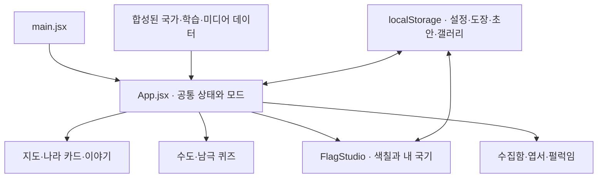
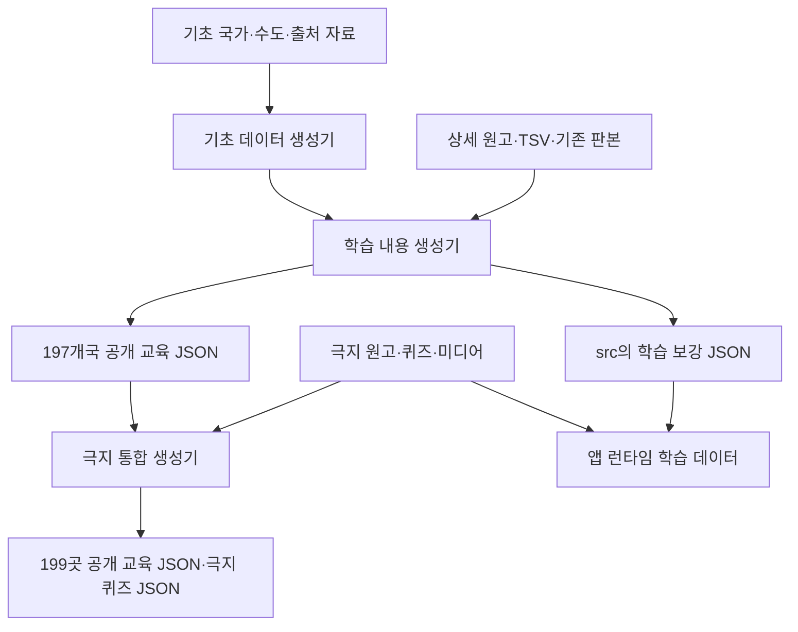
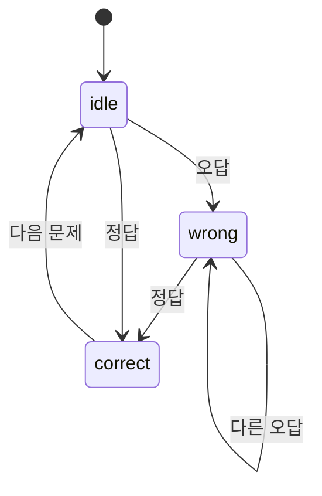

# 꼬마 세계 탐험대 — 개발·기능·콘텐츠·유지보수 통합 매뉴얼

> 문서 작성일: 2026-10-22 · Asia/Seoul  
> 기준 제품: 꼬마 세계 탐험대 / Little World Explorers  
> 확인한 공개 버전: Sites v32  
> 기준 소스 커밋: `6adb183459587979b878ab3eaa33cb0def69b30d`  
> 공개 주소: <https://flags.zap15.chatgpt.site>  
> 모든 파일 경로는 별도 표시가 없으면 **프로젝트 저장소 최상위 기준 상대 경로**다.

이 문서는 제품 인수인계, 기능 이해, 오류 수정, 퀴즈·이야기·태그·나라·이미지 추가, 테스트, 배포와 장기 유지보수를 위한 기준서다. 기존 README보다 내부 구조를 자세히 설명한다. **현재 구현**, **지금 사용할 수 있는 작업 절차**, **추가 개발이 필요한 확장안**을 구분한다. 확장 예시의 파일이나 기능이 이미 구현되어 있다고 해석하면 안 된다.

문서 작성 시 현재 v32의 소스·생성기·테스트·공개 상태를 확인했다. 국가·장소·이야기·키워드 수를 코드에서 다시 집계했고, 교육 데이터와 극지 자료의 재생성 일치 검사를 실행했다. 모든 외부 사실을 이번에 새로 조사한 문서는 아니다. 수도 변경·인구 갱신·문화유산 지위처럼 변하는 내용을 수정할 때는 해당 변경일에 공식 출처를 다시 확인한다.

## 목차

1. [제품 범위와 현재 상태](#1-제품-범위와-현재-상태)
2. [작업 이력과 남은 검수](#2-작업-이력과-남은-검수)
3. [개발 환경과 처음 실행하기](#3-개발-환경과-처음-실행하기)
4. [전체 구현 구조](#4-전체-구현-구조)
5. [파일별 역할 지도](#5-파일별-역할-지도)
6. [데이터 기준과 합성 순서](#6-데이터-기준과-합성-순서)
7. [지도·위치·수도 표시](#7-지도위치수도-표시)
8. [검색과 주요 학습 목록](#8-검색과-주요-학습-목록)
9. [현재 퀴즈 구현](#9-현재-퀴즈-구현)
10. [퀴즈 추가·수정 실무](#10-퀴즈-추가수정-실무)
11. [이야기·학습 내용 추가와 정정](#11-이야기학습-내용-추가와-정정)
12. [태그·키워드 관리](#12-태그키워드-관리)
13. [나라·지역·수도·인구 관리](#13-나라지역수도인구-관리)
14. [엽서 이미지 추가·교체](#14-엽서-이미지-추가교체)
15. [공식 국기 색칠 구현과 유지보수](#15-공식-국기-색칠-구현과-유지보수)
16. [나만의 국기·도형·자동 이름](#16-나만의-국기도형자동-이름)
17. [저장 형식·백업·이관](#17-저장-형식백업이관)
18. [펄럭임·언어·접근성·반응형 화면](#18-펄럭임언어접근성반응형-화면)
19. [테스트와 변경별 검증](#19-테스트와-변경별-검증)
20. [빌드·Sites·GitHub·ZIP 배포](#20-빌드sitesgithubzip-배포)
21. [장애 대응과 복구](#21-장애-대응과-복구)
22. [정기 유지보수와 개선 우선순위](#22-정기-유지보수와-개선-우선순위)
23. [변경 요청·콘텐츠 등록·릴리즈 서식](#23-변경-요청콘텐츠-등록릴리즈-서식)
24. [향후 구조 개선안](#24-향후-구조-개선안)
25. [용어·문서 갱신 규칙](#25-용어문서-갱신-규칙)

## 1. 제품 범위와 현재 상태

### 1.1 제품 목적

어린이가 한 페이지에서 지도를 탐험하고, 수도·지식 퀴즈를 풀고, 실제 국기를 색칠하며, 자신만의 나라와 국기를 만드는 학습 앱이다. 한국어와 영어를 지원한다. 선택한 나라와 개인 작품을 모드 간에 이어서 사용한다.

### 1.2 기준 수량

| 항목 | v32에서 확인한 값 | 해석 |
|---|---:|---|
| 기본 국가 목록 | 197개국 | 프로젝트에서 정한 학습 목록 |
| 추가 탐험지 | 2곳 | 그린란드 자치 지역, 남극 대륙 |
| 전체 탐험 목록 | 199곳 | 199개국으로 부르지 않음 |
| 수도 퀴즈 대상 목록 | 198곳 | 197개국과 그린란드; 수도·정부 소재지 등의 역할 구분 포함 |
| 남극 지식 문항 | 5개 | 남극에 가짜 수도를 부여하지 않음 |
| 주요 학습 국가 | 48개국 | 기본 학습 우선순위 |
| 이야기 | 995쌍 | 장소별 한국어·영어 5쌍; 197개국 985쌍 + 추가 2곳 10쌍 |
| 키워드 | 1,990쌍 | 장소별 한국어·영어 10쌍 |
| 엽서 연결 | 199곳 | 미리보기·큰 그림 경로 연결 |
| 도형·문양 | 20종 | 기본 사각형·원·선 3종 + 문양 17종 |
| 자동 이름 | 기본 400가지 | 색상 20개 × 동물 20개; 소진 시 숫자 확장 |
| v32 자동 검사 | 128개 통과 | v32 수정·배포 당시 결과; Sites 4개 검사를 포함한 수량 |

기본 목록은 `world-countries`의 독립 항목과 프로젝트 추가 항목 TW·PS·XK를 조합한다. 국가 인정의 보편적 결론을 뜻하지 않는다. 그린란드의 수도는 누크이며 남극 지도 핀은 세종과학기지다. 데이터에 기록된 수도 역할과 주석을 유지한다.

### 1.3 기능별 범위

| 기능 | 현재 동작 | 주 구현 파일 |
|---|---|---|
| 지도 탐험 | 나라 선택, 확대·축소, 반복 세계, 검색한 나라로 이동, 수도·연구기지 핀 | `src/App.jsx`, `src/data.js`, `src/map-geometry.js` |
| 시작 위치 | 탐험으로 새로 열면 무작위 장소; 가능한 한 직전 장소 제외 | `src/explorer-launch.js` |
| 나라 카드 | 수도·국기·한영 이름·인구·분류·개인 학습 기록 | `src/CountryCardFace.jsx`, `src/CountryCollection.jsx` |
| 이야기 | 장소별 5편 순환 읽기 | `src/App.jsx`, `src/learning-data.js` |
| 태그 검색 | 나라·수도 우선, 태그 후순위, 한 장소 한 결과 | `src/country-search.js` |
| 수도 퀴즈 | 같은 대륙의 실제 수도 3지선다, 지도 또는 글자 보기 | `src/quiz-data.js`, `src/CapitalQuizAnswers.jsx` |
| 남극 퀴즈 | 고정 지식 문제 목록 중 무작위 한 문제 | `src/polar-data.js` |
| 퀴즈 피드백 | 오답 재도전, 정답 후 약 900ms 자동 다음, 별·도장·선택 소리 | `src/quiz-advance.js`, `src/quiz-reward.js` |
| 공식 국기 색칠 | 영역 채우기, 실제 붓질, 질감, 지우개, 스포이드, 채점 | `src/OfficialFlagPaper.jsx`, `src/official-art.js` |
| 내 국기 | 도형·문양, 이동·크기·문양 회전, 태극 분리 색칠, 이름·카드 저장 | `src/FlagStudio.jsx`, `src/custom-shapes.js` |
| 작품 보관 | 기기 내 초안·갤러리, 재열기, SVG 다운로드·인쇄, 개인 카드 삭제 | `src/studio-drafts.js`, `src/art-gallery.js` |
| 국기 펄럭임 | WebGL 그림 표면, 하늘·엽서 배경, 바람·일시정지, 평면 대체 | `src/FlagWavePreview.jsx`, `src/flag-wave.js` |
| 큰 엽서 | 클릭 후 큰 이미지 로드, 재시도, 닫기, 저장 | `src/PostcardPreview.jsx` |
| 언어·접근성 | 한영, 이름 음성, 키보드 색칠, 초점 복귀, 움직임 줄이기 대응 | 여러 UI 모듈, `src/dialog-focus.js` |

### 1.4 현재 제공하지 않는 기능

운영용 콘텐츠 편집 관리자 화면, 서버 계정별 작품 동기화, 클라우드 갤러리, 작품 JSON 가져오기·내보내기 UI, 일반 국가의 범용 상식 문제 은행, 문제별 학습 성취 이력, 영상 내보내기, 오프라인 설치형 PWA를 구현된 기능으로 간주하지 않는다. 추가하려면 별도 설계와 개발이 필요하다. 현재 데이터 편집은 소스 파일을 수정하고 검사·빌드·재배포하는 방식이다.

## 2. 작업 이력과 남은 검수

### 2.1 구현 경과

| 단계 | 반영 내용 | 유지해야 할 결과 |
|---|---|---|
| 초기 학습 카드 | 상세 40개국과 공통 지도·수도·엽서 흐름 | 기존 나라별 장면과 저작·출처 기록 |
| 전체 국가 확장 | 197개국 한영 이름·수도·좌표·기초 학습·퀴즈 | 국가 코드 기준 연결, 수도 예외 설명 |
| 그림 도구 확장 | 실제 붓질, 도구별 질감, 지우개, 실행 취소, 초안 | 단순 전체 채우기와 붓질 구분 |
| 주요 48개국 | 참고 학습 목록, 카드 구조, 명칭·태그 보완 | 주요 목록과 전체 목록 함께 제공 |
| 개인 나라 | 이름, 도형·문양, 독립 태극 영역, 갤러리, 펄럭임 | 실제 국가 목록과 개인 나라 분리 |
| 엽서 완성 | 기존 40 + 새 생성 70 + 사용자 백업 통합 87 = 197개국 | 국가 커버리지와 대체 장면 수를 따로 셈 |
| 교육 내용 확장 | 197개국 5편·10태그, 한영 교육 데이터와 출처 | 이전 3편 판본 보존 기준 |
| 극지 추가 | 그린란드·남극, 별도 지식 문제와 상징·인구 분류 | 나라·자치 지역·대륙의 구분 |
| v31 최종 UX | 무작위 시작, 검색 우선순위, 퀴즈 보상·자동 다음, 초점·키보드 등 | 퀴즈 정답 노출 방지, 저장·재열기 |
| v32 / 2026-10-22 | 선 끝 가장자리 도달, 빈 이름 자동 저장, GitHub 문서·포장 | 선 이동은 실제 끝점 기준; 자동 이름은 저장 시 확정 |

예전 `CONTENT_GUIDE.md`, `artwork/README.md`, `AGENTS.md`의 중간 수량과 대기열은 당시 기록이다. 예를 들어 40개국·3편·70장·잔여 127개국 같은 기록을 현재 미완료 목록으로 다시 실행하지 않는다. 최신 수량은 실제 연결 파일과 현재 생성 결과로 확인한다.

### 2.2 검증 상태

v32는 전체 128개 자동 검사, 프로덕션 빌드, Sites 서버 검사, ZIP CRC와 실행 파일 바이트 대조를 통과하고 공개 배포됐다. v31의 대표 데스크톱 확인 기록은 별도로 보존되어 있다.

이번 변경을 포함한 실제 휴대폰 터치·짧은 화면·회전, 다양한 기기의 WebGL2 지도와 3D 렌더링, 모든 수도 핀의 독립 정밀 대조, 화면낭독기·음량·어린이 반응·실기기 초기 성능은 완료로 표시하지 않는다. 자동 검사와 배포 성공은 이 실사용 검수를 대신하지 않는다.

문서 작성 환경에서 v32의 코드 기반 수량과 다음 두 검사는 다시 확인했다.

```sh
npm run check:learning
node scripts/build-polar-learning.mjs --check
```

## 3. 개발 환경과 처음 실행하기

### 3.1 기술 구성

| 구분 | 현재 구성 |
|---|---|
| UI | React 19, React DOM |
| 개발·번들 | Vite 6, React Vite 플러그인 |
| 지도 | MapLibre GL JS 6, 별도 번들 Worker |
| 지도 데이터 | 로컬 Natural Earth / world-atlas 1:10m, topojson-client |
| 국가 데이터 | world-countries 5.1 계열 + 프로젝트 검토 자료 |
| 국기 원본 | lipis/flag-icons 7.5 계열 4:3 SVG |
| 아이콘 | Phosphor React |
| 상태·저장 | React 상태, Map·Ref·Timer, 브라우저 localStorage |
| Sites 실행 | 정적 클라이언트 + 간단한 Worker 자산 라우팅 |
| 데이터 생성 | Node.js 스크립트 |
| ZIP 포장 | Python 표준 라이브러리 |
| 이미지 전처리 | 별도 개발용 Sharp; 일반 앱 빌드에는 불필요 |

정확히 설치할 버전은 `package-lock.json`을 따른다. `package.json`의 범위 표기만 보고 임의로 최신 라이브러리로 올리지 않는다. 현재 package version `0.0.0`은 Sites v32와 다른 값이다. npm 버전 필드를 Sites 배포 버전으로 해석하지 않는다.

### 3.2 실행

Node.js는 프로젝트 README 기준 20.19 이상 또는 22.12 이상을 사용한다. 새 환경에서는 해당 계열의 지원되는 패치 버전을 선택하고 잠금 파일과의 호환성을 확인한다. Python 포장기를 사용한다면 `Path.is_relative_to`를 지원하는 Python 3.9 이상이 필요하다.

```sh
npm ci
npm run dev
```

프로덕션 결과 확인:

```sh
npm run build
npm run preview
```

일반 앱 구동에는 외부 지도 타일 API 키나 별도 DB가 필요 없다. 실제 요청은 배포한 사이트의 국기·지도 JSON·이미지 등으로 간다. 국기·엽서·교육 자료는 소스에 포함되어 있어 평소 빌드에 이미지 재생성이나 원본 백업 재다운로드가 필요하지 않다.

`file://`로 index.html을 두 번 클릭하는 실행은 지원하지 않는다. 개발 서버나 웹 서버를 사용한다. 기본 배포 경로는 도메인 루트이며 하위 경로는 20장에서 설명한 추가 점검이 필요하다.

### 3.3 처음 받은 사람이 할 일

1. 현재 커밋과 README의 기준 버전·날짜를 확인한다.
2. `npm ci`로 잠금 파일 기반 설치를 한다.
3. 교육 재생성 일치 검사를 실행한다.
4. `npm run build` 후 전체 테스트를 실행한다. Sites 검사도 전체에 포함된다.
5. 탐험·퀴즈·색칠·내 국기·저장·재열기 흐름을 브라우저에서 확인한다.
6. 원고 편집 전 원본 입력 파일과 생성 결과 파일을 구별한다.

## 4. 전체 구현 구조

### 4.1 실행 구조



`App.jsx`가 언어·선택 코드·모드·퀴즈·모달·도장을 연결한다. 국기 모드에서는 지도와 나라 상세 화면 대신 공방을 마운트한다. 한 페이지 설계는 모든 화면을 한꺼번에 펼친다는 뜻이 아니다.

`App.jsx` 내부에는 `MapView` 등 지도·탐험 관련 구현도 함께 있다. 현재 저장소에 별도 `MapView.jsx`가 있다고 가정하지 않는다. 모드 전환 시 공방이 재마운트되는 경우가 있어, 지속할 상태는 공방 내부 메모리만 믿지 않고 초안 저장 모듈로 연결한다.

### 4.2 콘텐츠 생성 구조



앱은 `src`의 합성 데이터를 사용하고 공개 교육 JSON은 별도 다운로드·재사용 자료다. `public/data` JSON 하나를 수정한다고 앱의 모든 문구가 바뀌지 않는다. 반대로 앱 원고만 수정하고 공개 교육 JSON을 재생성하지 않으면 배포 자료가 서로 달라진다.

## 5. 파일별 역할 지도

### 5.1 화면·상호작용

| 파일 | 책임 |
|---|---|
| `src/main.jsx` | React 진입점 |
| `src/App.jsx` | 공통 상태, 지도, 모드, 이야기, 퀴즈 연결, 이름 음성 |
| `src/styles.css` | 레이아웃·모바일·공방·모달·피드백 스타일 |
| `src/CountryCardFace.jsx` | 실제 장소 카드 앞면 |
| `src/CountryCollection.jsx` | 나라 수집함·개인 나라·필터·삭제 확인 |
| `src/MyCountryCard.jsx` | 개인 나라 카드 |
| `src/CountrySearch.jsx` | 공통 검색 입력과 키보드·선택 흐름 |
| `src/CountrySearchOptions.jsx` | 나라·태그 결과 공통 표현 |
| `src/ColourCountryPicker.jsx` | 색칠 대상 검색·선택 |
| `src/CapitalQuizAnswers.jsx` | 3개 보기·정오답·힌트 표시 |
| `src/FlagStudio.jsx` | 도구·팔레트·내 국기·저장·작품 갤러리 |
| `src/OfficialFlagPaper.jsx` | 실제 SVG 국기 기반 캔버스 색칠 |
| `src/FlagSymbol.jsx` | 중립 문양·복합 영역 렌더링 |
| `src/FlagWavePreview.jsx` | 펄럭임 모달·배경·컨트롤·대체 표시 |
| `src/PostcardPreview.jsx` | 경량 그림 버튼과 큰 그림 모달 |
| `src/dialog-focus.js` | 중첩 대화상자 초점 복귀 지원 |

### 5.2 데이터·순수 로직

| 파일 | 책임 |
|---|---|
| `src/data.js` | 기본/탐험/수도 목록, 핀·그림 합성, 지도 JSON 로딩 |
| `src/basic-country-data.json` | 생성된 기본 국가·수도·역할·좌표·원고 |
| `src/learning-data.js` | 초기 40개 상세 원고와 최종 학습 데이터 합성 |
| `src/priority-learning-data.js` | 추가 주요 국가 상세 원고 |
| `src/postcard-scene-data.js` | 일부 장면 연결 원고 보강 |
| `src/country-learning-enrichment.json` | 생성된 197개국 최종 5편·10태그 보강 |
| `src/polar-data.js` | 그린란드·남극 원고·장소·핀·이미지·상징·문제 |
| `src/population-data.json`, `src/population.js` | 인구 수치·출처·표시 |
| `src/priority-countries.js` | 주요 48개국 순서·그룹·교실용 표기 |
| `src/country-search.js`, `src/collection-data.js` | 검색 정규화·우선순위·수집함 검색 |
| `src/quiz-data.js` | 문제·보기 생성, 수도명·힌트·지도 프레임 |
| `src/quiz-answer-state.js` | 답할 수 있는 상태와 정오답 표시 |
| `src/quiz-advance.js` | 취소 가능한 정답 후 자동 이동 |
| `src/quiz-reward.js` | 칭찬·별 문구·옵트인 소리 |
| `src/progress.js` | 발견/정답 코드 집합, 학습 묶음 |
| `src/explorer-settings.js`, `src/explorer-launch.js` | 설정 검증·저장·시작 국가 |
| `src/map-geometry.js`, `src/map-highlight.js` | 날짜변경선·나라 중심 이동·정답 노출 방지 |
| `src/map-failure.js` | 그래픽 미지원과 로딩 실패 구분 |
| `src/official-art.js` | 공식 국기 색 영역 분리·질감·면적 채점 |
| `src/flag-art.js` | 내 국기·이전 형식의 영역·붓질·채점 |
| `src/custom-shapes.js`, `src/flag-symbols.json` | 도형·문양 정의, 이동·크기·분리 영역 |
| `src/country-names.js` | 빈 이름의 색상+동물 조합 |
| `src/studio-drafts.js`, `src/art-gallery.js` | 초안·갤러리·저장 정합성 |
| `src/flag-reward.js` | 색칠 결과와 펄럭임 보상의 연결 |
| `src/flag-wave.js` | WebGL 메시·변형·셰이더·렌더러 |
| `src/shape-hold.js`, `src/keyboard-paint.js`, `src/colour-picker.js` | 길게 누르기·키보드·스포이드 |

### 5.3 입력·에셋·운영 문서

| 경로 | 책임 |
|---|---|
| `sources/` | 원고 TSV, 출처, 인구 추출, 과거 3편 판본 |
| `public/data/` | 지도·공개 교육 JSON·자료 ZIP·고지 |
| `public/flags/` | 실제 앱이 읽는 199개 SVG와 라이선스 |
| `public/assets/postcards/` | 웹용 그림·full·preview |
| `artwork/postcards/` | 국가별 프롬프트·출처·장면·검토 메타데이터 |
| `artwork/postcard-media-index.json` | 원본·미리보기의 해시·크기 검증 |
| `artwork/postcard-progress.json` | 그림 작업 이력; 최종 사용자 백업 통합 여부도 별도 기록과 대조 |
| `README.md` | 제품·실행·GitHub 업로드 요약 |
| `TASKS.md` | 잔여 업무·검증·배포 이력 기준표 |
| `AGENTS.md` | 작업자 지침과 사용자 결정 이력 |
| `THIRD_PARTY_NOTICES.md` | 데이터·소프트웨어 재사용 고지 |
| `ODbL-1.0.txt`, `PHOSPHOR_ICONS_LICENSE.txt` | 원본 라이선스 고지 |
| `.openai/hosting.json` | Sites 식별자·호스팅 설정 |
| `worker/index.js` | 정적 자산 및 HTML 경로 fallback |
| `scripts/`, `tests/` | 데이터·빌드·포장과 회귀 검사 |

## 6. 데이터 기준과 합성 순서

### 6.1 식별자 원칙

국가·장소는 `KR`, `FR`, `GL`, `AQ` 같은 안정된 2자리 코드로 연결한다. 파일명은 보통 소문자 코드다. 번역한 이름·배열 순서·제작 번호로 파일을 연결하지 않는다. 숫자 ISO 코드와 국가 코드는 별개다. 예: 지도 TopoJSON 연결은 숫자 코드도 사용한다.

개인 나라는 UUID 카드 ID를 사용한다. 개인 나라의 `code`는 연결된 실제 장소의 배경·작업 맥락을 가리킬 수 있으며 개인 국가가 실제 지도 목록에 편입됐다는 의미가 아니다.

### 6.2 학습 데이터 우선순위

`src/learning-data.js`의 실질 순서:

1. `basic-country-data.json` 기초 원고.
2. 초기 4개 배치 원고와 `priorityLearningData`가 같은 국가를 대체.
3. `postcardSceneData`의 장면 원고를 병합.
4. `country-learning-enrichment.json`이 `facts`, `keywords`, `sources`, 검토 정보를 최종 덮어씀.
5. `population-data.json`의 수치를 `population2025`에 적용.
6. `polarLearningData`로 GL·AQ를 추가.

따라서 초기 원고만 편집하면 4단계 JSON에 가려 화면이 바뀌지 않을 수 있다. 생성 결과만 편집하면 다음 `build:learning`에서 변경이 사라진다. **현재 보이는 문장을 먼저 찾고, 그 문장의 원본 입력과 생성 경로를 함께 고친다.**

### 6.3 위치·그림 우선순위

`src/data.js`는 기초 수도 좌표, 생성 그림 매핑, 초기 40개국 장면 정의, 사용자 백업 그림 매핑을 합성하고 마지막에 `postcard-media.json`의 full/preview 정보를 덧붙인다. GL은 별도 수도 자료를, AQ는 별도 연구기지 `explorationPoint`를 사용한다.

초기 40개국 일부 수도 좌표는 `data.js`의 명시 항목에도 있다. `basic-country-data.json`만 바꾸고 이 값이 남으면 앱 핀과 문서 값이 어긋날 수 있다. 실제 최종값은 `capitalPoints[code]` 또는 `explorationPoints[code]`에서 확인한다.

### 6.4 입력과 출력의 구분

| 바꿀 내용 | 주 입력 | 재생성·확인할 출력 |
|---|---|---|
| 기본 수도·좌표·역할 | `scripts/build-basic-country-data.mjs`, `sources/worldbank-countries.json` 등 | `src/basic-country-data.json`, `public/data/learning-basics.json` 등 생성기 출력 |
| 137개국 이야기 2·3 | `sources/learning-stories-20261002.tsv` | 최종 보강 JSON·공개 교육 JSON; 판본 보존 검사도 검토 |
| 기존 상세 국가 이야기 1~3 | `src/learning-data.js`, `src/priority-learning-data.js`, `src/postcard-scene-data.js` | 위와 같음; 최종 보강층과 일치시킴 |
| 모든 기본 국가 이야기 4·5 | `sources/learning-extra-stories-20261002.tsv` | 위와 같음 |
| 기본 국가 원고 출처 | `sources/learning-enrichment-sources.json`, `sources/learning-story-expansion-sources.json` | `public/data` 출처 사본·학습 데이터 |
| GL·AQ 전체 학습·퀴즈 | `src/polar-data.js` | 극지 교육 JSON·출처·퀴즈 JSON |
| 기본 국가 인구 | UN 추출 원본과 `scripts/build-population-data.mjs` | `src/population-data.json`, 학습 교육 JSON |
| 엽서 | 이미지 파일 + 매핑·미디어·메타데이터 | 최종 핀 객체·미리보기·원본·교육 장면 캡션 |

## 7. 지도·위치·수도 표시

### 7.1 지도 로딩

`loadCountryGeoJson()`이 `public/data/countries-10m.json`을 읽는다. TopoJSON을 GeoJSON으로 바꾸고 각 지형에 코드·한영 이름·지역·학습 가능 여부를 붙인다. 지도는 모든 배경 지형을 그리되 선택 가능한 학습 목록은 `eligible`로 구분한다.

외부 타일 서버를 사용하지 않는 단순한 색상 지형 레이어 구조다. MapLibre Worker는 Vite의 worker URL로 번들링한다. Worker 경로를 임의의 고정 파일명으로 바꾸면 배포된 해시 자산에서 초기화가 실패할 수 있다.

### 7.2 좌표·도형 유지 규칙

- 좌표 순서는 **`[경도, 위도]`**다. 지도 핀에 국가 중심점을 수도처럼 쓰지 않는다.
- ±180° 경계를 지나는 다각형은 `splitAntimeridianGeometry()`로 나눈다. 러시아·태평양 국가가 세계 전체를 덮는 도형이 되지 않도록 한다.
- 나라 이동은 주요 육지와 인접 섬을 고려하는 `countryFocusBounds()`와 현재 반복 세계에 가까운 `nearestWorldBounds()`를 사용한다.
- 같은 검색 결과를 다시 선택해도 새 focus request가 생겨 재중심 이동해야 한다.
- 수도 핀의 중심과 라벨 크기를 분리한다. 긴 이름 때문에 실제 위경도 앵커가 움직이면 안 된다.
- 바티칸의 정밀 도형 예외는 `src/vatican-geometry.json`에 있다.
- AQ는 위도 제한과 넓은 영역 때문에 별도 focus bounds를 사용한다.

### 7.3 지도 관련 수정을 한 뒤

대한민국, 러시아, 미국, 피지, 키리바시, 바티칸, 그린란드, 남극을 포함해 선택·검색·수도 핀·반복 세계·이동 후 재검색을 확인한다. 지도 퀴즈에서는 정답 나라의 채움과 테두리가 보이지 않아야 한다. 드래그·핀치·취소된 포인터 동작이 나라 선택 또는 답안 제출로 이어지지 않아야 한다.

## 8. 검색과 주요 학습 목록

### 8.1 검색 순위

`normalizeCountryQuery()`는 유니코드 분해, 발음 구별 기호 제거, 소문자화, 문자·숫자 외 요소 제거를 수행한다.

| 순위 | 매칭 |
|---:|---|
| 0 | 나라 이름·별칭 완전 일치 |
| 1 | 수도 완전 일치 |
| 2 | 나라·수도 앞부분 일치 |
| 3 | 나라·수도 부분 일치 |
| 4 | 태그 완전 일치 |
| 5 | 태그 앞부분 일치 |
| 6 | 태그 부분 일치 |

나라·수도 일부 일치도 태그 완전 일치보다 앞이다. 한 장소는 한 결과로 표시한다. 태그 결과에는 어떤 키워드 때문에 나온 것인지 함께 보관한다. 예: `석회암` 검색으로 쿠바를 찾는 기능은 키워드 검색이며 별도의 나라 이름 별칭이 아니다.

태그 인덱스는 모듈 초기화 시 `learningData`에서 만든다. 향후 관리자 화면에서 내용을 실시간 수정하는 구조를 추가한다면 현재의 정적 인덱스를 다시 만드는 절차도 필요하다.

### 8.2 주요 48개국과 묶음

주요 목록은 `src/priority-countries.js`의 `priorityGroups`와 `priorityCountryCodes`다. 국가를 제거·추가하거나 순서를 바꿀 때 다음을 같이 검토한다.

- 주요 카드 목록과 기본 퀴즈 순서.
- `quizPool()`이 만드는 중복 없는 우선순위 목록.
- 기본 48, 전체 197·199 설정과 UI 라벨.
- `readExplorerSettings()`가 허용하는 pool size 값.
- 주요 학습 국가 수를 고정한 테스트·README·집계.

카리브해·중앙아메리카 국가를 남아메리카로 옮기지 않는다. 퀴즈 대륙 구분은 `Americas` 안에서도 South America와 North America로 나뉜다.

## 9. 현재 퀴즈 구현

### 9.1 문제 생성 방식

일반 국가의 수도 퀴즈는 수동으로 문제 한 줄씩 등록하는 방식이 아니다. `capitalQuizOptions(code, random)`가 국가·수도 목록에서 정답과 오답 두 개를 구성한다.

1. 정답 국가를 찾는다.
2. 같은 퀴즈 대륙에서 다른 국가를 고른다.
3. 수도명이 중복되지 않는 세 도시를 만든다.
4. 지도 프레임에서 도시가 지나치게 겹치지 않는 조합을 우선 고른다.
5. 정답·오답 순서를 함께 섞는다.
6. 하나의 문제 스냅샷을 지도 핀과 A/B/C 이름 보기에 같이 사용한다.

현재 UI 설정 `difficulty: 'word'`는 이름 보기, `'mixed'`는 지도에서 찾기다. **이름이 mixed라고 해서 현재 코드가 문제마다 지도·글자 방식을 무작위 혼합하는 것은 아니다.** `createQuizQuestion()`은 word가 아니면 map을 반환한다. 지도 그래픽 미지원 시 App이 word로 대체한다. AQ는 설정과 관계없이 knowledge다.

### 9.2 문제·보기의 형태

```js
{
  type: 'word', // 또는 'map', 'knowledge'
  options: [
    {
      id: 'KR',
      code: 'KR',
      answer: 'Seoul',
      nameKo: '서울',
      name: 'Seoul',
      coordinates: [126.978, 37.5665],
      correct: true
    }
    // 오답 보기 2개
  ]
}
```

지식 문제에는 별도 `id`, `prompt: {ko, en}`가 있고 각 보기에는 `hint: {ko, en}`를 붙일 수 있다. 수도 보기의 `id`는 국가 코드, 남극 보기의 `id`는 문제와 보기를 합친 고유 문자열이다. 표시 순서 A/B/C를 정답 ID로 저장하지 않는다.

### 9.3 정오답 상태와 자동 이동



`idle`, `wrong`에서는 다시 답할 수 있고 `correct`에서만 보기를 잠근다. 오답 시 정답 보기까지 표시하지 않는다. `answerLock`은 연속 클릭으로 같은 정답을 중복 처리하지 않게 한다.

정답 뒤 `createQuizAdvance()`가 약 900ms 타이머를 만든다. 모드·문제·묶음 변경, 검색·수집함 열기, 문서 숨김 등의 상황에서는 취소한다. 오래된 타이머가 새 문제를 건너뛰지 않도록 revision과 문제 스냅샷을 확인한다. 새 UI 모달을 추가한다면 자동 이동의 blocked 조건에도 반영한다.

### 9.4 지도에서 정답 숨기기

`src/map-highlight.js`의 선택 국가 fill·outline 레이어를 퀴즈 동안 숨긴다. 탐험용 수도 핀도 퀴즈 표시와 분리한다. 정답 나라의 윤곽·채움·깃발·수도 이름이 문제를 풀기 전에 노출되는지 확인한다. A/B/C 보기와 지도 핀의 대응 순서는 매 렌더에서 별도로 섞지 않는다.

### 9.5 보상과 기록

- `sessionCorrect`: 현재 방문에서 맞힌 수. 국가를 반복해서 맞혀도 증가할 수 있다.
- `progress.solved`: 맞힌 국가 코드의 중복 없는 집합.
- `progress.discovered`: 발견한 국가 코드의 중복 없는 집합.
- 세 정답마다 세 별 완성 문구, 오답 후 정답이면 재도전 칭찬.
- 정답 소리는 기본 꺼짐. 사용자가 켠 뒤 정답 행동에서만 재생.
- 퀴즈 소리 설정은 현재 영구 설정에 저장하지 않는다.

남극 문항 5개를 모두 풀었는지는 현재 `solved: ['AQ']`만으로 알 수 없다. 문제별 성취율을 추가하려면 별도 저장 스키마가 필요하다.

## 10. 퀴즈 추가·수정 실무

### 10.1 원하는 작업부터 구분하기

| 요청 | 현재 가능한 변경 경로 | 추가 개발 여부 |
|---|---|---|
| 기존 국가의 수도 정정 | 기초 수도·역할·좌표·원고 수정 후 재생성 | 데이터 정합성 수정 필요 |
| 수도 오답 선택 방식 개선 | `capitalQuizOptions()` 후보·분리 기준 수정 | 로직 수정 |
| 남극 지식 문제 1개 추가 | `antarcticQuestions`에 등록 | 작은 데이터·검사 변경 |
| 다른 국가에도 동물·음식·유산 문제 추가 | 공통 지식 문제 은행과 국가별 출제 경로 설계 | 현재 미구현 |
| 3지선다를 4지선다로 변경 | 생성기·UI·지도·모바일·검사 모두 변경 | 현재 미지원 |
| 국가별 문제 이력·반복 학습 | 문항 ID별 기록·추천·저장 이관 | 현재 미구현 |
| 정답 후 이동 시간 변경 | `createQuizAdvance()` delay와 사용 경험·검사 변경 | 로직 수정 |

### 10.2 남극 지식 문제 한 개 추가

편집 파일: `src/polar-data.js`의 `antarcticQuestions` 배열. 그 위의 `question()` 도우미가 실제 보기 객체를 만든다.

아래는 **배열 내부에 넣는 형식 예시**다. ID는 기존 5개와 겹치지 않게 하고 실제 채택 전 출처·한영 문장을 검토한다.

```js
question(
  'research-work',
  '세종과학기지에서 하는 일로 알맞은 것은 무엇일까요?',
  'What is an appropriate activity at King Sejong Station?',
  [
    ['science', '과학 연구', 'Scientific research', true],
    ['capital', '남극의 수도 운영', 'Running Antarctica’s capital'],
    ['palace', '그린란드 왕궁 관리', 'Managing a Greenlandic palace']
  ],
  {
    ko: '세종과학기지는 남극의 연구기지예요. 남극에는 수도가 없어요.',
    en: 'King Sejong Station is an Antarctic research station. Antarctica has no capital.'
  }
),
```

등록 절차:

1. 문항 ID, 보기 ID, 한영 질문·보기·힌트를 작성한다.
2. 정답 `true`는 정확히 한 보기에만 지정한다. 나머지의 생략된 값은 false다.
3. 세 보기는 중복되지 않게 한다. 답안 순서에 의존하는 문구를 피한다.
4. 공식 출처를 `antarcticSources`와 콘텐츠 검토 기록에 반영한다.
5. `node scripts/build-polar-learning.mjs`로 공개 데이터도 갱신한다.
6. 5문항을 고정한 집계·테스트·패키지·문구를 찾아 새 수량과 기대 결과로 수정한다.
7. 아래 검사 후 한국어·영어, 오답 재시도·정답·다음 문제를 확인한다.

```sh
node scripts/build-polar-learning.mjs --check
node --test tests/polar-destinations.test.mjs tests/word-quiz.test.mjs tests/quiz-flow.test.mjs tests/mobile-update.test.mjs
npm run build
npm run test:sites
```

`build-polar-learning.mjs`의 마지막 출력 문구도 현재 five Antarctic knowledge questions로 고정되어 있다. 새 문항 수를 반영하거나 배열 길이에서 계산하도록 바꾼다. 테스트를 통과시키기 위해 문항 검사를 제거하지 않는다.

### 10.3 일반 국가 지식 퀴즈 확장안 — 현재 미구현

권장 설계는 수도와 별개인 콘텐츠 유형을 둬서 국가별 문제 목록을 읽게 하는 것이다. 예시 이름 `src/knowledge-questions.js`는 **새로 만들 후보 파일**이며 현재 존재하는 기능이 아니다.

```js
// 신규 스키마 제안
{
  id: 'KR-knowledge-001',
  countryCode: 'KR',
  kind: 'knowledge',
  category: 'culture',
  prompt: { ko: '질문', en: 'Question' },
  options: [
    { id: 'a', nameKo: '정답', name: 'Correct answer', correct: true },
    { id: 'b', nameKo: '오답 1', name: 'Wrong answer 1', correct: false },
    { id: 'c', nameKo: '오답 2', name: 'Wrong answer 2', correct: false }
  ],
  explanation: { ko: '해설', en: 'Explanation' },
  sources: ['https://official-source.example/document'],
  reviewedAt: 'YYYY-MM-DD'
}
```

`official-source.example`은 형식 설명용 자리표시자이며 실제 출처가 아니다.

개발할 연결 지점:

| 영역 | 해야 할 일 |
|---|---|
| 문제 은행 | 국가별 배열, 문항·보기 ID 유일성, 출처·검토일 |
| 생성기 | `createQuizQuestion()`에서 요청 유형과 데이터 유무에 따라 출제 |
| UI | 현재 word/mixed 외 지식·섞기 설정, 실제 없는 유형의 fallback |
| 해설 | 새 explanation을 정답 후에 보여줄지와 시간 설계; 현재는 오답 hint 경로가 중심 |
| 지도 | 지식 문제에서 수도 핀·지도 정답 영역을 사용하지 않도록 분리 |
| 자동 다음 | 900ms가 해설 읽기에 충분한지; 수동 다음 또는 별도 지연 결정 |
| 순서 | 국가 순환과 국가 안의 문항 순환을 구분; 직전 문제 반복 회피 |
| 저장 | 국가 도장과 문제별 정답·오답을 분리; 기존 v1 저장과 이관 |
| 검사 | 문제 완전성·언어·출처·정답 1개·반복·취소·오래된 타이머·모바일 |

한 국가에 배열을 추가하는 것만으로 현재 App이 이를 출제하지는 않는다. 특히 현재 `createQuizQuestion()`의 지식 분기는 `code === 'AQ'`로 되어 있다. 범용화하려면 이 분기와 학습 묶음 필터까지 함께 바꾼다.

### 10.4 수도 퀴즈 수정

정답을 하드코딩한 새 배열을 만들기 전에 `basicCountryData` → `roster` → `capitalPoints` → `capitalQuizOptions()` 흐름을 고친다. 예외 수도는 `capitalRole`, `capitalNote`도 수정한다.

오답 후보 변경 시 지켜야 할 조건:

- 현재 기준은 정답과 같은 퀴즈 대륙의 실제 다른 국가 수도 두 개다.
- 세 수도 이름은 중복되지 않고 좌표가 유효해야 한다.
- 지도 핀과 글자 보기의 순서·ID는 한 문제 스냅샷을 공유한다.
- 지도 간격 추정값 48은 실제 모든 기기의 물리적 48px 간격 보장이 아니다. 작은 화면에서 별도 확인한다.
- 태평양 도시는 `quizMapFrame()`의 가장 큰 빈 경도 간격을 기준으로 펼쳐 한 화면에 묶는다.
- 수정 후 모든 대상 국가를 순회하는 검사와 예외 수도 검사를 유지한다.

## 11. 이야기·학습 내용 추가와 정정

### 11.1 학습 항목 형식

```js
{
  facts: [
    { ko: '한국어 이야기', en: 'English story' }
    // 현재 총 5쌍
  ],
  keywords: [
    { ko: '한국어 단어', en: 'English term', type: 'nature', artwork: true }
    // 현재 총 10쌍
  ],
  sources: ['https://실제-공식-출처'],
  contentReview: {
    kind: '검토 유형',
    checkedDate: 'YYYY-MM-DD'
  }
}
```

출처 배열의 실제 자료와 문장 사이에 근거 관계가 있어야 한다. 동일 출처를 붙였다고 모든 문장이 검증된 것으로 표시하지 않는다. 독창적인 비교·관찰 활동과 외부 사실을 구별한다.

### 11.2 현재 4·5번째 이야기 수정

가장 직접적인 기본 국가 수정 경로다.

편집 파일: `sources/learning-extra-stories-20261002.tsv`.

한 줄은 다음 **5열, 실제 탭 구분**이다.

```text
CODE<TAB>KO_STORY_4<TAB>EN_STORY_4<TAB>KO_STORY_5<TAB>EN_STORY_5
```

`<TAB>` 글자를 그대로 저장하지 않는다. 원고 안에 탭·실제 줄바꿈을 넣으면 열·레코드가 깨진다. 국가 코드는 한 줄씩이며 현재 197개국 모두 있어야 한다.

작업 순서:

1. 수정할 국가의 한 줄과 관련 출처 항목을 찾는다.
2. 한국어·영어 두 언어를 함께 고친다. 현재 생성기는 각 문장 길이가 15자를 넘는지와 반복 여부도 검사한다.
3. `sources/learning-story-expansion-sources.json`의 해당 국가 출처·검토 메타데이터를 수정한다.
4. 아래 명령으로 기본·극지 교육판을 순서대로 다시 생성한다.
5. Git diff에서 대상 국가 외 불필요한 변경이 없는지 확인한다.
6. 앱의 4/5·5/5 화면과 두 언어를 확인한다.

```sh
npm run build:learning
node scripts/build-polar-learning.mjs
npm run check:learning
node scripts/build-polar-learning.mjs --check
node --test tests/learning-enrichment.test.mjs tests/polar-destinations.test.mjs
```

`npm run build`만으로 교육 원고 JSON을 재생성하지 않는다. 콘텐츠 변경 시 위 단계를 먼저 수행한다.

### 11.3 1~3번째 이야기 정정 시 주의

현재 생성기는 `sources/learning-three-story-edition.json`을 **역사적 3편 판본**으로 가져와 기존 이야기·키워드가 정확히 같아야 한다고 검사한다. 137개국 원고, 초기 상세 원고 또는 키워드를 바꾸면 의도적인 변경이어도 이 검사가 실패할 수 있다.

이것은 단순 캐시 문제가 아니다. 이전 판본 보존이라는 제품 규칙이 코드에 들어 있기 때문이다. 검사 삭제나 과거 판본의 조용한 덮어쓰기를 기본 해법으로 삼지 않는다.

권장 정정 절차 — 생성기 변경을 포함한 작업:

1. 오류 문장, 실제 원고 위치, 현재 생성 결과, 과거 보존 판본을 함께 찾는다.
2. 공식 출처와 새 한영 문장을 정리하고 정정 사유·일자를 남긴다.
3. 이전 3편 판본과 공개 ZIP은 보존한다.
4. 생성기에 **검토된 정정 레이어**를 새로 두어 과거 판본 검사를 통과한 원본에 승인된 수정만 적용하거나, 새 기준 판본을 별도 파일명·edition으로 만든다.
5. 정정한 국가·문장만 달라지고 나머지가 보존되는 검사를 추가·수정한다.
6. 기본·극지 데이터와 교육 자료 ZIP, 인덱스·고지·문서 수량을 갱신한다.

정정 레이어는 현재 별도 파일로 구현되어 있지 않다. 이 절차가 필요한 경우 먼저 도입해야 한다. `country-learning-enrichment.json`을 손으로 고쳐 임시로 화면만 맞추는 처리는 재현 가능한 유지보수가 아니다.

### 11.4 새 이야기를 6번째로 추가하기

화면의 이야기 화살표는 `learning.facts.length`를 사용하므로 일부 렌더링은 가변 길이를 처리한다. 하지만 제품 전체는 현재 5편을 기준으로 만들어져 있다. 데이터 한 줄만 더 넣어 끝나는 변경이 아니다.

변경할 범위:

- 추가 원고의 새 입력 형식 또는 새 edition.
- `build-learning-enrichment.mjs`의 facts 수·storyCount·추가/보존 집계.
- `build-polar-learning.mjs`의 모든 장소 5편 검사와 총합.
- 교육 ZIP 생성기의 고정 5편·985·995 등의 검사·문서.
- `learning-enrichment.test.mjs`, `polar-destinations.test.mjs`, `mobile-update.test.mjs`의 기대 수량·1/5 표시 검사.
- 개별 국가만 6편일지 모든 장소가 6편일지에 따른 UI·학습 정책.
- 나라 이동 또는 실시간 데이터 교체 후 `storyIndex` 범위가 유효한지.

길고 많은 이야기를 추가할수록 저사양 기기 번들 크기와 읽기 부담도 확인한다.

### 11.5 GL·AQ 이야기 수정

`src/polar-data.js`의 `polarLearningData.GL/AQ.facts`, `keywords`, `sources`, `contentReview`를 고친다. 이후 `node scripts/build-polar-learning.mjs`를 실행한다. 일반 국가 TSV를 수정하는 작업과 분리한다. 남극 수도·인구·상징의 분류는 원고를 늘려도 유지한다.

### 11.6 편집 원칙

한 편은 한두 개의 구체적 사실과 어린이의 관찰·비교·활동으로 구성한다. 한영 내용이 같은 의미인지 확인한다. 과장된 최고·최초, 현재 공사 완료 예측, 국가 전체를 한 문화로 단정하는 표현을 피한다. 유네스코 잠정목록·생물권보전지역·등재 세계유산을 구분한다. 엽서 속 장소와 수도가 다르면 둘을 연결하되 핀은 실제 수도·표시 역할 위치에 둔다.

## 12. 태그·키워드 관리

### 12.1 기본 구조와 제약

현재 장소마다 한영 태그 10개이며 같은 언어에서 정규화 후 중복이 없어야 한다. 기본 국가의 수도 키워드와 그림 연결 키워드도 검사한다.

실제 사용 중인 `type` 값에는 다음이 있다.

`animal`, `art`, `city`, `craft`, `culture`, `engineering`, `festival`, `film`, `food`, `gem`, `geography`, `history`, `industry`, `landmark`, `language`, `music`, `nature`, `place`, `science`, `sport`, `transport`, `writing`.

이는 현재 코드의 고정 enum 선언이 아니라 실제 자료에서 확인한 분류다. 새 유형을 도입할 때 향후 필터나 문제 생성기가 그 유형을 어떻게 사용할지 정한다. `artwork: true`는 그 나라의 현재 엽서에서 실제 찾을 수 있는 요소를 표시하는 의미이며 별 난이도가 아니다.

### 12.2 태그 변경 경로

137개국은 `sources/learning-stories-20261002.tsv`의 마지막 열에 다음 형식을 쓴다.

```text
한국어|English|type;한국어|English|type;...
```

현재 이 입력은 **9개 후보 태그**이고 생성기가 수도 태그와 엽서 장면 태그를 보강·정규화해 최종 10개로 만든다. 10개라고 생각하고 TSV에 10개를 넣으면 입력 검사가 실패한다. `|`, `;`, 탭은 구분자이므로 태그 본문에 사용하지 않는다.

기존 상세 국가는 초기 상세 원고·주요 원고·장면 원고에서 시작하며 최종 보강 JSON이 덮어쓴다. 태그도 이전 3편 판본과의 완전 일치 검사 대상이므로, 정정이 필요하면 11.3절의 판본 정책을 적용한다.

변경 후 확인:

1. 한영 태그 10쌍, 한영 각각 중복 없음.
2. 수도 키워드와 적절한 그림 태그 유지.
3. 이름·수도 검색이 태그보다 먼저 나옴.
4. 관련 태그 검색으로 해당 나라가 나옴.
5. 같은 나라가 여러 태그로 중복 표시되지 않음.
6. 기본·극지 공개 JSON·교육 ZIP도 최신 내용과 일치.

```sh
node --test tests/country-search.test.mjs tests/tag-search-ui.test.mjs tests/learning-enrichment.test.mjs
```

### 12.3 태그 수를 늘리는 경우

현재 10개 고정 검사와 집계가 생성기·테스트·자료 포장에 있다. 12개로 늘리려면 그 수량 정책을 함께 바꾸고, 검색 결과가 많아졌을 때 모바일 스크롤·결과 선택·키보드 인덱스를 확인한다. 검색 인덱스는 태그 배열 길이를 순회하지만 제품 전체가 무제한 태그를 지원한다고 단정할 수 없다.

## 13. 나라·지역·수도·인구 관리

### 13.1 이름·별칭 수정

교실 표기는 `src/priority-countries.js`의 `classroomNames`를 우선 확인한다. 이전 패키지 명칭은 검색 별칭으로 남을 수 있다. `name/nameKo`, 기본 원고·공개 데이터, SVG alt, 카드·퀴즈·음성까지 확인한다. 번역 이름을 바꾸더라도 코드나 저장된 개인 작품 ID를 바꾸지 않는다.

### 13.2 수도·좌표 정정

1. 수도인지 헌법상 수도·행정 수도·정부 소재지인지 결정할 공식 근거를 확보한다.
2. `scripts/build-basic-country-data.mjs`의 `capitalKo`, 영어 예외, `overrides`, `roles`, `notes`, 좌표 출처 항목을 확인한다.
3. `node scripts/build-basic-country-data.mjs`로 기초 데이터를 만든다.
4. `src/data.js`의 초기 40개국 명시 좌표가 정정값을 덮어쓰는지 확인한다.
5. 1번째 이야기·수도 태그·과거 판본 정책을 점검한다.
6. `build:learning`과 극지 통합 데이터를 재생성한다.
7. 나라 카드, 수도 핀, 지도·글자 퀴즈, 오답 힌트, 이름 검색을 확인한다.

기초 생성기는 기존 데이터 모듈과 연결되어 있어 전체 목록 확대 시 순환 의존·초기 자료 부재 문제도 점검해야 한다. 새 국가를 패키지 목록에 추가한 뒤 기초 레코드가 없는 상태로 모듈을 먼저 실행하면 `.capital` 접근 단계에서 실패할 수 있다.

### 13.3 새로운 국가·지역을 추가하는 경우

현재는 일반적인 국가 등록 관리자 기능이 없다. 기본 197개국 집합에 넣는 것과 추가 탐험지로 넣는 것은 서로 다른 변경이다.

필수 연결 목록:

| 영역 | 확인할 항목 |
|---|---|
| 식별·분류 | 중복 없는 code·numericCode, 이름·별칭, 국가/지역/대륙, region·subregion |
| 목록 | roster·explorationRoster·capitalQuizRoster·countryByCode·숫자 코드 맵 |
| 지도 | 실제 지형 연결·선택 가능 여부·focus bounds |
| 위치 | 수도 또는 연구기지 등 역할에 맞는 핀·좌표·출처 |
| 학습 | 한영 5편·10태그·출처·검토일 |
| 퀴즈 | 수도·지식·출제 제외 중 선택; 같은 대륙 오답 후보 유효성 |
| 국기 | SVG 파일, 공식/비공식 표기, 자산 준비 스크립트 |
| 그림 | 대표 장면·미리보기·큰 그림·캡션·메타데이터 |
| 인구 | 별도 출처·기준일 또는 해당 없음; 가짜 수치 금지 |
| 저장·설정 | 기존 설정 코드 유효성, 갤러리 valid code 검사, pool size |
| 자료 | 공개 JSON·ZIP·수량·README·검사 |

GL·AQ는 현재 `polar-data.js`에서 추가하는 선례다. 비극지 추가 지역을 이 파일에 무조건 늘리기보다 범용 추가 장소 모듈로 분리하는 편이 낫다. 단, 그 분리는 향후 설계이며 현재 구현은 polar 모듈이다.

### 13.4 인구 업데이트

기본 197개국은 UN WPP2024 중위 추계의 **2025-07-01** 값을 사용한다. 입력은 천 명 단위이며 `build-population-data.mjs`가 ×1,000 후 반올림한다. `value`, `year`, `variant`, `locationCode`를 보관한다. GL은 Statistics Greenland 등록 인구, AQ는 상주 주민 없음 설명이다.

업데이트 시 다음을 한 번에 바꾼다.

- 실제 새 원본·추출값·국가 코드 대응·원본 해시·라이선스·검토일.
- `build-population-data.mjs`의 연도·variant·원본 열 조건.
- `src/population.js`의 출처 문자열과 URL.
- `population2025` 같은 연도 포함 필드명 사용처. 새 연도 값만 넣고 2025 이름을 계속 쓰지 않도록 설계한다.
- App·카드의 인구 연도 라벨.
- 공개 교육 데이터·출처·README·고지·인구 테스트.

일부 국가만 최신 자료로 바꾼다면 공통 연도 라벨이 잘못되지 않도록 국가별 메타데이터 표시도 바꿔야 한다. 국가 센서스·추계·등록 인구를 같은 성격으로 표현하지 않는다.

## 14. 엽서 이미지 추가·교체

### 14.1 현재 파일 체계

| 역할 | 파일·데이터 |
|---|---|
| 대표 생성 그림 매핑 | `src/postcard-assets.json` |
| 사용자 백업 그림 매핑 | `src/postcard-imports.json` |
| 원본·미리보기 URL/치수 | `src/postcard-media.json` |
| GL·AQ 그림 | `src/polar-data.js`의 `polarPostcards` |
| 웹용 그림 | `public/assets/postcards/` |
| 큰 그림 | 보통 `public/assets/postcards/full/`; 일부 기존 URL 유지 |
| 경량 미리보기 | `public/assets/postcards/preview/` |
| 장면 원고·프롬프트·검토 | `artwork/postcards/<code>.json` 등 |
| 파일 검증 | `artwork/postcard-media-index.json`, 극지 메타데이터 |

미리보기는 최대 폭 640px·WebP 품질 78 기준으로 만들어졌고 원본을 확대하지 않는다. 큰 그림은 클릭한 뒤에만 ``가 마운트된다. 앱 카드의 contain 표시로 높은 건축물 등을 자르지 않는다.

### 14.2 새 그림 제작·연결

이미 199곳에 그림이 연결되어 있다. 신규 제작은 누락 대기열을 재개하는 작업이 아니라 새 국가·대체 장면·품질 개선의 목적을 먼저 정하는 작업이다.

제작 기준은 가로 3:2 수채화·과슈 여행책 스타일이다. 해당 원고에 근거한 장소를 사용하고, 그림 내부 글자·가짜 국기·워터마크를 넣지 않는다. 실제 사진·정밀 측량 자료로 설명하지 않는다.

`integrate-postcards.mjs`는 **기존 대표 그림이 없는 생성 국가를 추가하는 도구**이며 기존 파일을 보존하도록 중복 시 중단한다. manifest에는 최소 다음 데이터가 필요하다.

```json
[
  {
    "code": "KR",
    "path": "/ABSOLUTE/PATH/postcard-generation/originals/kr.png",
    "landmark": "English scene caption",
    "landmarkKo": "한국어 장면 캡션",
    "prompt": "실제 사용한 프롬프트",
    "inspection": "실제 검토 결과",
    "sources": ["https://official-source.example/scene"]
  }
]
```

위 경로·출처·KR은 구조 설명용이다. KR은 이미 연결되어 있으므로 이 예시를 그대로 실행하면 기존 그림 보존 검사에 막혀야 정상이다. 원본 경로는 스크립트가 정한 저장소 옆 `postcard-generation` 작업 폴더 안이어야 한다.

```sh
node scripts/integrate-postcards.mjs /absolute/path/reviewed-manifest.json
```

이 스크립트는 웹용 1024px 품질 87과 원본 해상도 품질 94 WebP를 만든다. **현재 최종 앱은 `postcard-media.json`의 full/preview 정보도 사용하므로, 위 명령만으로 신규 미리보기·큰 그림 연결까지 끝났다고 판단하지 않는다.** 미디어 데이터와 인덱스를 함께 준비한다.

### 14.3 기존 국가의 대체 장면

`integrate-postcard-variant.mjs`는 한 국가의 대체 장면을 처리하며 기존 메타데이터·그림·고해상도 출력을 보존한다.

```sh
node scripts/integrate-postcard-variant.mjs /absolute/path/one-scene-manifest.json kr-new-scene kr-previous-scene.json
```

실제 도입 전 해당 국가의 현재 매핑과 메타데이터가 이 도구의 전제에 맞는지 확인한다. 사용자 백업 기반 국가나 초기 40개국에 이 경로를 그대로 적용하면 안 맞을 수 있다.

대체 후 필수 점검:

1. 실제 최종 `capitalPoints[code].fullImage/previewImage/landmark` 확인.
2. `postcard-imports.json`·초기 명시 항목·`postcard-media.json`에 남은 값이 새 매핑을 덮어쓰는지 확인.
3. 별도 이름의 full·preview 파일과 해당 치수·해시를 만들고 미디어 인덱스 갱신.
4. 장면 캡션·이야기·`artwork` 태그 일치.
5. 원본·과거 장면 보존. 대체 장면 수로 국가 커버리지를 부풀리지 않음.
6. 엽서 확대와 펄럭임의 엽서 배경에서 같은 장면 표시.

현재 저장소에 임의의 한 장만 교체하고 모든 미디어 인덱스를 자동 갱신하는 범용 도구가 있다고 가정하지 않는다. 일괄 도구 `prepare-postcard-media.mjs`는 과거 전체 백업·생성 출력·선택 인덱스를 전제로 하고 기존 파일 보존 검사도 한다. 두 원본 디렉터리가 없으면 일상적인 한 장 수정에 무리하게 실행하지 않는다.

### 14.4 이미지 전처리 환경

Sharp는 일반 앱 의존성에 별도 선언되어 있지 않다. 도구는 Codex 런타임 모듈 경로 또는 로컬 `sharp`를 사용한다. 일반 환경에서 전처리가 필요하면 별도 작업용 설치 또는 검토된 개발 의존성 추가가 필요하다. 앱 실행을 위해 모든 사용자에게 이미지 도구를 설치하도록 요구하지 않는다.

일부 과거 스크립트의 `reviewedAt`, preparedAt 등은 2026-10-01로 고정되어 있다. 새 제작물을 통합할 때 실제 검토일·도구 provenance를 기록하도록 수정한다. 사용자 제공 그림에 AI 생성 프롬프트를 추정해 붙이지 않는다.

### 14.5 이미지 검증

```sh
node --test tests/postcard-assets.test.mjs tests/postcard-media.test.mjs tests/guide-postcards.test.mjs tests/polar-destinations.test.mjs
```

실제 파일 존재, 디코딩 가능성, 3:2 비율, 미리보기 크기, 원본 해시, 한영 캡션, 선택 장면을 확인한다. 브라우저 네트워크에서 작은 카드가 큰 그림을 미리 받지 않는지도 별도로 확인한다.

## 15. 공식 국기 색칠 구현과 유지보수

### 15.1 두 가지 그림 형식

공식 색칠과 내 국기는 같은 공방 UI를 쓰지만 내부 표현이 다르다.

| 구분 | 공식 국기 색칠 | 내 국기·이전 형식 |
|---|---|---|
| 작업 좌표 | 640×480 | SVG 600×400 |
| 원본 | 실제 `flags/<code>.svg` | 사용자 도형 배열 |
| 영역 | SVG를 픽셀로 분석한 연결 영역 | 사각형·원·선·문양의 기하 영역 |
| 편집 기록 | `actions`의 fill/stroke/erase | `colors`, `shapes`, `strokes` |
| 렌더 | Canvas 2D | SVG + 마스크·질감 패턴 |
| 출력 | PNG 그림층을 내장한 SVG | 도형·붓질·패턴을 포함한 SVG |
| 과거 형식 | `legacy` 항목으로 구분 | 기존 템플릿·저장 그림 호환 |

두 좌표계를 섞지 않는다. 공식 색칠의 `actions[].region`은 분석 모델 영역 ID이고 내 국기의 `region`은 배경·도형·부분 영역 식별자다.

### 15.2 실제 국기에서 영역 만들기

`OfficialFlagPaper`는 4:3 SVG를 불러와 640×480 캔버스에 래스터화한다. `svgPaintColors()`로 원본 색 정보를 얻고 `splitFlagPixels()`가 색을 정리한 뒤 연결된 영역을 분리한다. 같은 색이라도 떨어진 줄무늬는 다른 영역이다. 원본의 안티앨리어싱을 새 색 영역으로 잘못 세지 않도록 한다.

아주 작은 문장·문양은 손으로 누르기 어려워 `locked`로 원본 색을 보존한다. 현재 잠금 기준은 연결 영역 픽셀 수 `<24`다. 이 수치는 640×480 작업 해상도와 함께 해석해야 한다. 해상도를 바꾸면 영역 모델·잠금 크기·저장 actions의 영역 ID 호환성까지 영향을 받는다.

### 15.3 도구 처리

| 도구 ID | 동작 |
|---|---|
| `paint` | 클릭한 영역 전체 채움 |
| `crayon` | 고정 종이 결의 거친 질감 붓질 |
| `pencil` | 연필 해칭 붓질 |
| `marker` | 겹침을 보여 주는 사인펜 질감 |
| `eraser` | 시작 영역 안의 붓질을 지워 흰 종이로 복원 |
| `eyedropper` | 보이는 색을 읽고 이전 그리기 도구로 복귀 |

붓질은 시작 영역의 마스크 안에서만 그린다. 손이 다른 영역으로 나가도 다른 국기 부분에 칠해지지 않아야 한다. pointer capture, 취소, lost capture, 두 번째 손가락, 모드 변경을 처리한다. 도구는 아이콘과 이름이 있는 직접 버튼을 유지한다.

공식 국기의 액션 예시:

```js
{ kind: 'fill', region: 3, color: '#ed2939' }
{
  kind: 'stroke', region: 3, color: '#ed2939', tool: 'pencil', size: 24,
  points: [[100, 120], [110, 125]]
}
{
  kind: 'erase', region: 3, tool: 'eraser', size: 24,
  points: [[105, 122], [115, 128]]
}
```

위 예시는 배열에 들어가는 개별 객체의 모양이다. 원본 SVG 변경으로 region ID가 바뀌면 기존 액션이 다른 곳에 적용될 수 있다. 국기 패키지 버전 또는 분석 알고리즘 변경은 단순한 그림 파일 교체 이상의 호환성 변경이다.

### 15.4 채점과 펄럭임 보상

`gradePixels()`는 보호 영역을 제외한 실제 면적에서 기대 색과 비교한다. 투명한 붓질은 흰 종이 위에 합성한 색으로 비교한다. 흰 영역의 빈 종이는 정답으로 인정하며 다른 색을 덮으면 오답이 된다.

질감의 작은 빈틈 때문에 점수가 부당하게 내려가지 않도록 `OfficialFlagPaper.grade()`는 질감 대신 같은 행동의 의미상 색칠 레이어를 그려 채점한다. 실제 화면의 질감은 유지한다.

펄럭임 자격은 `src/flag-reward.js`의 **accuracy ≥0.9**다. 표시값은 정수 퍼센트이며 경계값은 원래 실수 accuracy로 판단한다. 국기 코드와 채점한 그림 내용을 `paintingKey`로 묶는다. 수정한 그림에 예전 채점 보상이 그대로 열리지 않아야 한다.

`complete`는 개별 영역들의 90% 조건도 고려하므로 전체 accuracy에 따른 펄럭임 자격과 완전히 같은 의미가 아니다. UI 문구와 점수 임계값을 바꿀 때 두 개념을 구분한다.

### 15.5 국기 원본 교체

`npm run build`의 첫 단계 `prepare-flag-assets.mjs`는 설치된 flag-icons의 SVG를 `public/flags`로 **다시 복사**한다. public SVG만 손으로 수정하면 다음 빌드에서 사라질 수 있다.

원본 정정이 필요하면 패키지 버전 변경 또는 프로젝트 override 자산·복사 규칙을 설계하고 고지를 유지한다. GL·AQ까지 전체 탐험 목록을 순회하므로 새 장소를 넣으면 해당 코드의 SVG를 찾을 수 있어야 한다. 비공식 상징의 공식 국기 오인 방지 문구도 같이 검토한다.

## 16. 나만의 국기·도형·자동 이름

### 16.1 기본 데이터

```js
{
  colors: { '0': '#ffffff', '1': '#ffdd00', '2:0': '#ee0000', '2:1': '#0000ee' },
  shapes: [
    { type: 'rect', x: 100, y: 100, width: 200, height: 100 },
    { type: 'symbol', symbol: 'taegeuk', x: 225, y: 125, width: 150, height: 150, rotation: 0 }
  ],
  strokes: [
    { region: 1, tool: 'pencil', color: '#123456', size: 20, points: [[120, 130], [140, 150]] }
  ],
  actions: [],
  countryName: '파란코뿔소',
  englishName: '',
  savedCountryId: 'stable-card-id'
}
```

배경은 region 0, 첫 도형은 1, 그다음은 2다. 태극처럼 독립 부분이 있으면 `2:0`, `2:1` 같은 키를 쓴다. `savedCountryId`는 갤러리 카드의 실제 `id`와 연결한다.

### 16.2 현재 도형·문양

기본 3종: `rect`, `circle`, `line`.

문양 17종: `star`, `taegeuk`, `crescent`, `cross`, `maple`, `sun`, `six-star`, `triangle`, `diamond`, `oval`, `pentagon`, `hexagon`, `eight-star`, `cloud`, `heart`, `multiply`, `divide`.

문양의 기하 정의는 `flag-symbols.json`의 `id`, 한영 라벨, viewBox, parts의 경로·구멍·부분 영역·원본 국기 정보다. 새 문양은 원래 국가의 색을 가져오지 않고 **중립 흰 종이**로 추가한다. 사용자가 칠한 색은 유지한다.

### 16.3 이동·크기·회전·선 끝 문제

`createShape()`, `moveShape()`, `resizeShape()`, `shapeBounds()`가 공통 기하 로직이다. 회전은 문양에 적용하며 역변환 hit test와 붓질 좌표 변환을 함께 처리한다.

v32의 직선 수정 원칙:

- 선택 테두리는 선 주위 4px 여백을 포함한다.
- 이동 제한은 이 선택 테두리 대신 **실제 선 양 끝점의 최소·최대 좌표**를 사용한다.
- 끝점은 x=0·600, y=0·400에 닿을 수 있다.
- 수평·수직 선의 선택 bounds는 양의 크기를 유지한다. 이를 0으로 만들면 붓질 변환에서 0으로 나누는 문제가 생길 수 있다.
- 선이 역방향이어도 같은 규칙을 사용한다.

다른 도형을 이동할 때는 기존 종이 내 bounds 제한을 유지한다. 선택 영역 표시와 실제 도형의 기하 제한을 한 목적의 데이터로 섞지 않는다.

### 16.4 터치·삭제·실행 취소

`shape-hold.js`의 기본 기준은 약 480ms 누르기와 8px 이동 거리다. 누르기 전 이동은 그림 그리기로, 정지된 길게 누르기는 편집으로 해석한다. 다른 pointer ID가 첫 손가락 동작을 종료하면 안 된다.

도형 선택 시 종이 위 휴지통이 약 2초 나타난다. 삭제 버튼에 키보드 초점이 있을 때 숨기는 과정의 초점 복귀도 유지한다. 삭제 시 해당 도형 색·붓질을 제거하고 뒤 도형들의 region을 다시 매긴다. 배열 한 항목만 지우면 색이 다른 도형으로 옮겨 붙을 수 있다.

한 번의 이동·크기 변경 동작은 실행 취소 한 단계로 남겨야 한다. 같은 방문의 undo 이력은 제한된 메모리 스택이며 전체 이력을 새로고침 뒤 복원하지 않는다.

### 16.5 새 문양 추가 절차

1. `src/flag-symbols.json`에 고유 ID·한영 라벨·viewBox·parts를 등록한다.
2. 기존 공식 SVG 기하를 사용한다면 sourceFlag와 MIT 고지를 보존한다.
3. 원본 fill을 옮기지 않고 중립 형태로 렌더되는지 확인한다.
4. 구멍과 서로 다른 색칠 영역을 구분한다. 필요하면 `region`을 나누고 mask·hit test를 검증한다.
5. `symbolContains()`에 별도 분석 기하가 필요한지 확인한다. 현재 태극에는 전용 분기 처리가 있다.
6. 회전·크기·이동 후 영역 선택, 칠하기·지우기·삭제·undo·갤러리·재로드를 검사한다.
7. 20종 고정 수량 테스트와 문서 수량을 갱신한다.

브라우저가 없는 Node 환경에서 Path2D가 없는 문양은 더 단순한 hit 판정을 사용할 수 있다. Node 검사 통과만으로 복잡한 문양의 실제 포인터 hit test를 확정하지 않는다.

### 16.6 빈 이름의 자동 저장

`src/country-names.js`의 `resolveCountryName(art, gallery, random)`이 처리한다.

1. 사용자가 입력한 `countryName`이 trim 후 남으면 60자 이내로 유지한다.
2. 빈 경우 색상 20개 × 동물 20개 전체 조합을 만든다.
3. 다른 저장된 개인 카드의 한글 이름과 같은 이름을 제외한다.
4. 남은 후보 중 하나를 무작위로 고른다.
5. 400개가 모두 사용 중이면 한 기본 이름에 2부터 번호를 붙이고 기존 번호 이름도 피한다.
6. 같은 카드를 갱신할 때는 자기 자신의 ID를 중복 검사에서 제외한다.

`FlagStudio.makeItem()`은 저장 직전 현재 저장소를 다시 읽어 이름을 정하고 `serialize(countryName)`에 같은 이름을 전달한다. **이름을 바꾼 뒤 React 렌더를 기다려 SVG를 만드는 방식이 아니다.** 카드 이름·SVG title·다운로드 이름이 같아야 한다.

저장이 성공한 뒤 입력란·초안에도 확정 이름과 카드 ID를 반영한다. 실패하면 이름을 확정 저장한 것처럼 표시하지 않는다. 영어 이름은 선택이며 자동 한국어 이름 때문에 기존 영어 입력을 지우지 않는다. 중복 회피는 현재 브라우저 저장 목록 기준이다. 다른 주소·기기 전체의 전역 이름 등록 시스템은 아니다.

색상·동물 목록을 늘리면 자동 조합 수와 테스트를 함께 갱신한다. 이미 저장된 이름은 다시 무작위로 바꾸지 않는다.

## 17. 저장 형식·백업·이관

### 17.1 localStorage 키

| 키 | 내용 | 지속성 |
|---|---|---|
| `world-explorer-settings-v1` | language, selectedCode, mode, poolSize, difficulty | 설정 저장 |
| `world-explorer-progress-v1` | discovered, solved 코드 배열 | 학습 도장 |
| `world-flag-draft-v1:<CODE>` | 국가별 공식 색칠 초안 | 국가별 분리 |
| `world-flag-draft-v1:custom` | 내 국기 현재 작업 초안 | 개인 공방 공통 초안 |
| `world-flag-gallery-v1` | 저장한 공식 작품·개인 나라 카드 배열 | 갤러리 |

위 키는 실제 v32 기준이다. 새로운 기능을 위해 같은 키의 구조를 무심코 바꾸지 않는다.

설정 reader는 저장된 quiz 모드를 그대로 재개하지 않고 탐험으로 복귀한다. explore 시작은 직전 코드와 가능한 한 다른 임의 장소를 고른다. colour/custom 시작에서는 해당 작업 초안을 유지한다. 허용된 언어·코드·묶음·방식만 읽는다.

### 17.2 초안

초안 저장 형태는 대략 다음과 같다.

```js
{
  version: 1,
  art: { colors: {}, shapes: [], strokes: [], actions: [] },
  ink: '#002395',
  tool: 'paint',
  size: 24,
  extra: []
}
```

메모리 캐시로 현재 방문의 그림과 history를 유지하고, localStorage에는 history를 제외해 저장한다. 공방은 약 250ms 지연 저장과 종료 시 저장을 사용한다. 저장 공간 문제에도 현재 화면의 그림을 버리지 않도록 한다. 검증에서 손상된 항목을 읽을 수 없으면 새 종이를 제공하되 기존 사용자 데이터를 무조건 삭제하지 않는다.

### 17.3 갤러리 카드

| 필드 | 의미 |
|---|---|
| `id` | UUID 등 안정된 작품 ID |
| `code` | 연결된 실제 장소 코드 |
| `custom` | 개인 나라 여부 |
| `countryName`, `englishName` | 정리한 이름; 60자 이내 |
| `colors`, `shapes`, `strokes`, `actions` | 다시 편집할 그림 상태 |
| `legacy` | 이전 그림 방식 구분에 사용 |
| `svg` | 저장 시점의 출력 그림 |
| `tool` | 재열 때 선택 도구 |
| `createdAt` | ISO 시각 |
| `savedCountryId` / `savedArtworkId` | 편집 중 원래 카드와의 연결 |

현재 같은 ID로 저장하면 앞 카드가 새 값으로 교체된다. 새 국기를 만들면 별도 자산으로 저장한다. `createdAt`은 저장 항목을 새로 만드는 과정에서 다시 설정되므로 최초 생성일과 최종 수정일을 각각 보관하는 이력 모델은 아니다. 두 날짜가 필요하면 새 필드와 호환 reader를 설계한다.

`completedCountry()`와 `completedFlag()`는 현재 그림과 저장 항목의 내용이 같은지 비교해 완료 후 인쇄·다운로드·펄럭임 UI를 제어한다. 저장하지 않은 수정이나 저장 실패 후에 이전 완성 그림의 동작을 잘못 열지 않도록 한다.

### 17.4 저장 이벤트·기기 범위

`world-flag-gallery-change`는 같은 문서 내 갤러리 변경 알림이다. `storage` 이벤트는 같은 origin의 다른 탭 변경을 반영한다. 현재 모델은 서버 트랜잭션이 아니므로 동시 편집·쓰기 충돌 병합을 제공하지 않는다.

저장은 **프로토콜·도메인·포트가 같은 origin의 브라우저 공간**에 묶인다. flags 사이트의 작품이 GitHub Pages나 새 도메인으로 자동 이전되지 않는다. 시크릿 세션 종료·브라우저 데이터 삭제·용량 부족을 고려해 중요한 작품은 SVG로 별도 보관한다.

### 17.5 유지보수자용 저장 백업

일반 사용자에게 제공되는 백업은 SVG 다운로드다. SVG는 보이는 작품 복사본이며 이를 앱으로 가져와 편집 상태를 완전히 복원하는 기능은 현재 없다.

정밀 데이터 이관 기능을 개발하거나 문제를 조사할 때는 사용자의 요청과 동의 범위 안에서 **현재 앱 origin의** 키만 백업한다. 아래는 개발자 콘솔에서 앱 관련 값만 JSON으로 받는 예시다. 다른 사이트·관계없는 키를 수집하지 않는다.

```js
const keys = Array.from({ length: localStorage.length }, (_, i) => localStorage.key(i))
  .filter(key => key && (
    key === 'world-explorer-settings-v1' ||
    key === 'world-explorer-progress-v1' ||
    key === 'world-flag-gallery-v1' ||
    key.startsWith('world-flag-draft-v1:')
  ));
const values = Object.fromEntries(keys.map(key => [key, localStorage.getItem(key)]));
const blob = new Blob([JSON.stringify({ schemaVersion: 1, values }, null, 2)],
  { type: 'application/json' });
const url = URL.createObjectURL(blob);
const link = document.createElement('a');
link.href = url;
link.download = 'world-explorer-browser-backup.json';
link.click();
setTimeout(() => URL.revokeObjectURL(url), 1000);
```

이 예시는 앱에 내장된 메뉴가 아니다. 원본을 덮어쓰는 자동 복구 코드는 제공하지 않는다. 이관 UI를 개발할 경우 먼저 import 검증, 기존 갤러리와의 충돌 처리, 미리보기·수량 확인, 되돌리기를 설계한다.

### 17.6 스키마 변경 원칙

기존 v1을 읽는 경로를 보존하고 새 버전의 필드·기본값·변환을 명시한다. 알 수 없는 코드·도형·손상 JSON으로 앱이 깨지지 않아야 한다. 구버전 예제 데이터로 새 reader 테스트를 하고 저장 실패 시 기존 값이 남는지 확인한다. 스키마가 호환되지 않는 새 앱을 배포한 뒤 옛 앱으로 롤백할 때도 사용자 데이터가 읽힐지 평가한다.

## 18. 펄럭임·언어·접근성·반응형 화면

### 18.1 펄럭임 구현

`flag-wave.js`는 WebGL로 삼각형 메시를 만들고 저장한 정확한 SVG를 텍스처로 사용한다. 왼쪽 가장자리를 고정한 표면에 바람·시간에 따른 변위를 주고 깃대·조명을 그린다. 정확한 물리 시뮬레이터나 동영상 내보내기 기능은 아니다.

`FlagWavePreview`는 하늘 기본 배경, 연결된 장소의 엽서 배경, 바람 세기, 일시정지를 제공한다. WebGL 미지원·컨텍스트 소실 등에서는 평면 SVG로 대체한다. 배경 이미지 로딩 실패가 국기 자체를 없애지 않아야 한다. 닫힐 때 RAF와 WebGL 자원을 정리하고 reduced motion 환경을 존중한다.

지도에서 필요한 그래픽 환경과 펄럭임 렌더러의 환경은 완전히 같은 조건이 아니다. 지도 실패 하나만으로 모든 학습·평면 작품 표시를 막지 않는다.

### 18.2 언어 추가·문구 수정

현재 ko/en 문구는 App의 copy, 개별 컴포넌트의 `tr(ko,en)`, 데이터의 `{ko,en}`에 나뉘어 있다. 단일 중앙 i18n 사전이 아니다.

문구를 수정할 때 본문뿐 아니라 다음을 같이 확인한다.

- 버튼, placeholder, title, aria-label, aria-describedby.
- 오류·재시도·저장 실패·정답·오답·자동 이름 알림.
- 국기·그림 alt와 수도 역할·분류.
- 긴 이름 줄바꿈, 이름 듣기 언어 코드.
- `document.documentElement.lang`.

제3언어는 버튼 하나만 추가하는 작업이 아니다. 저장 허용값, 데이터 언어 필드, 검색 정렬·정규화, 음성, 테스트와 고지까지 확장해야 한다. 언어 코드를 통합 관리하는 구조로 옮기는 것이 선행 개선안이다.

### 18.3 모바일·접근성 규칙

상단 한 줄에 브랜드·모드·검색·도장·언어를 유지하며 좁은 화면은 축약·가로 이동을 활용한다. 검색 결과가 상단 overflow에 잘리지 않게 한다. 짧은 화면에서는 내부 스크롤 또는 접기 기능으로 조작을 모두 열 수 있어야 한다.

키보드로 검색 결과 선택, 색칠 영역 이동·채우기, 모달 닫기·초점 복귀, 도형 이동·삭제·Escape 취소를 확인한다. 선택 상태를 색만으로 전달하지 않는다. 애니메이션·소리의 활성화를 기본 필수 조건으로 만들지 않는다. 이름 음성은 브라우저의 `speechSynthesis` 지원과 설치된 음성에 따라 달라진다.

## 19. 테스트와 변경별 검증

### 19.1 표준 검사 순서

처음 설치한 소스 ZIP에는 dist가 없으므로 **빌드를 먼저 한 뒤 전체 테스트**를 한다. Sites 테스트 중 하나가 빌드 결과 파일 존재를 확인하기 때문이다.

```sh
npm ci
npm run check:learning
node scripts/build-polar-learning.mjs --check
npm run build
node --test tests/*.test.mjs
```

이 전체 테스트에 Sites 4개가 포함된다. Sites만 다시 확인해야 할 때 `npm run test:sites`를 사용한다. 현재 `npm test` 또는 lint 스크립트가 선언되어 있다고 가정하지 않는다.

콘텐츠를 변경했다면 check 전에 아래 생성 단계를 먼저 수행한다.

```sh
npm run build:learning
node scripts/build-polar-learning.mjs
```

### 19.2 테스트 파일 지도

| 분야 | 주요 테스트 파일 |
|---|---|
| 기본 국가·좌표·메타데이터 | `country-data.test.mjs`, `population.test.mjs` |
| 학습 원고·이전 판본·공개 JSON | `learning-enrichment.test.mjs` |
| 극지·추가 목록·상징·문제 | `polar-destinations.test.mjs` |
| 나라·태그 검색 | `country-search.test.mjs`, `tag-search-ui.test.mjs` |
| 수집함·개인 카드 삭제 | `collection.test.mjs` |
| 지도 기하·날짜변경선 | `map-geometry.test.mjs` |
| 퀴즈 보기·동일 대륙·표시 | `word-quiz.test.mjs`, `mobile-update.test.mjs` |
| 정답 노출·타이머 | `quiz-flow.test.mjs` |
| 무작위 시작·초점·소리·기본 UX | `final-ux.test.mjs`, `explorer-settings.test.mjs` |
| 공식 국기 분석·채점 | `official-art.test.mjs`, `flag-art.test.mjs` |
| 펄럭임 보상·메시 | `flag-reward.test.mjs`, `flag-wave.test.mjs` |
| 개인 도형·분리 영역·이름 | `custom-flags.test.mjs`, `custom-flag-update.test.mjs` |
| 누르기·초안·공방 완료 상태 | `shape-hold.test.mjs`, `studio-drafts.test.mjs`, `studio-workflow.test.mjs` |
| 엽서 연결·원본·미리보기 | `postcard-assets.test.mjs`, `postcard-media.test.mjs`, `guide-postcards.test.mjs` |
| 캐시 해시 호환 | `release-compat.test.mjs` |
| Worker·빌드 산출물 | `sites-worker.test.mjs` |

모든 경로는 `tests/` 아래다. 일부 UI 검사는 esbuild와 React 서버 마크업 렌더를 사용한다. **실제 브라우저 GPU·터치·시각 검수는 아니다.**

### 19.3 변경별 최소 검증

| 변경 | 우선 확인 | 릴리즈 전 추가 확인 |
|---|---|---|
| 한 국가 이야기 4·5 | 재생성 일치, 해당 국가·판본 보존 | 두 언어 화면·전체 검사 |
| 수도·좌표 | 국가·지도 기하·전체 수도 보기 | 지도 핀·검색·예외 역할·전체 검사 |
| 새 남극 문제 | 정답 1개·보기 3개·ID·언어·수량 | 오답·정답·자동 다음·전체 검사 |
| 태그 | 최종 10쌍·검색 우선순위 | 모바일 결과·공개 자료·전체 검사 |
| 엽서 교체 | 실제 파일·원본·preview·hash | 확대·실패 재시도·펄럭임 배경 |
| 도형·이름 | 기하·중복 회피·저장·재열기 | 포인터·키보드·undo·quota 실패 |
| 국기 SVG/분석 | 연결 영역·잠금·정답률·옛 actions | 여러 복잡한 국기·저장 재열기 |
| CSS | 한국어·영어·긴 이름·짧은 화면 | 실제 휴대폰·확대·키보드 |
| 의존성 | lock diff·빌드·전체 검사 | 지도 Worker·Canvas·WebGL·캐시 |

### 19.4 실사용 회귀 체크리스트

- [ ] 탐험 첫 진입과 재진입이 정상이며 공방 초안은 복원된다.
- [ ] 한영 나라·수도·태그 검색, 한글 입력 조합, 키보드 선택, 같은 나라 재검색.
- [ ] 주요 48·전체·방문·내 나라 필터와 긴 이름.
- [ ] 이야기 앞뒤·장소 변경·5편 내용·큰 그림 열기/닫기/실패 재시도.
- [ ] 정답 지형 숨김, 도시 3개 프레임, 오답 후 다른 답, 정답 중복 클릭 방지.
- [ ] 정답 후 자동 다음, 검색·수집함·탭 숨김·모드 전환 중 잘못된 이동 없음.
- [ ] 색칠 도구 6종, 영역 밖 붓질 제한, 흰색·오답색·지우개·스포이드.
- [ ] 정답률 90% 경계와 수정 후 보상 잠금.
- [ ] 도형 20종, 태극 두 부분, 역방향 선·전체 폭 선·가장자리 이동.
- [ ] 짧은 탭·길게 누름·이동·두 번째 손가락·pointercancel.
- [ ] 빈 이름 자동 저장, 수동 이름, 기존 카드 업데이트·새 카드 분리.
- [ ] 초안·갤러리·SVG·인쇄·개인 카드 삭제 취소·확정.
- [ ] 펄럭임 하늘·엽서 배경·바람·일시정지·WebGL 대체.
- [ ] 키보드만 사용, 모달 Escape, 초점 복귀, reduced motion.
- [ ] 좁고 짧은 휴대폰 화면, 회전, 스크롤·브라우저 확대.
- [ ] 기록 저장 실패 시 그림을 유지하고 이해할 수 있는 안내 표시.

검수 기록에는 기기·브라우저·화면 크기·언어·검사일·통과/미검증/실패를 남긴다. 작은 화면 CSS가 있다고 실제 휴대폰 확인 완료로 표시하지 않는다.

## 20. 빌드·Sites·GitHub·ZIP 배포

### 20.1 빌드 단계

`npm run build`가 다음 순서로 실행된다.

1. `prepare-flag-assets.mjs`: 199개 SVG와 원본 고지 준비.
2. `vite build`: `dist/client` 생성.
3. `prepare-sites-build.mjs`: Worker·호스팅 설정을 dist에 복사.
4. `prepare-release-compat.mjs`: 현재 앱·스타일 진입점과 과거 해시 별칭 준비.

결과:

| 출력 | 용도 |
|---|---|
| `dist/client/index.html` 및 자산 | 일반 정적 웹 실행 파일 |
| `dist/server/index.js` | Sites Worker |
| `dist/.openai/hosting.json` | Sites 빌드 설정 |

기존 큰 JavaScript 번들 경고가 있다. v32 수정 당시 앱 JS는 약 2.97MB, gzip 약 0.77MB였으며 향후 변경에 따라 달라진다. 빌드 성공과 저사양 기기 초기 로딩 성능은 별도다.

### 20.2 캐시 호환 처리

과거 HTML이 이전 해시 JS·CSS를 계속 요청할 수 있어 `prepare-release-compat.mjs`가 알려진 파일명에 현재 진입점으로 이어지는 작은 별칭을 만든다. v32는 이전 v31의 `index-DqP99QHQ.js`도 여기에 추가했다.

새 릴리즈 시 이전 공개 index.html의 해시와 새 빌드 해시를 확인한다. 필요한 이전 진입점을 보존하되 현재 번들을 자기 자신으로 import하는 루프를 만들지 않는다. `release-compat.test.mjs`를 유지한다. URL의 임의 쿼리 값 하나가 모든 브라우저 캐시를 자동으로 완전히 없애는 보장은 없다.

### 20.3 Sites 릴리즈 원칙

기존 flags 프로젝트를 재사용하고 현재 공개 범위를 유지한다. 사이트 ID를 제목·URL에서 추정하지 않고 `.openai/hosting.json` 또는 Sites 응답의 실제 값을 사용한다. 소스 원격 저장소와 사이트 주소는 서로 다르다.

일반 순서:

1. 기존 프로젝트·소스·접근 범위 확인.
2. 작업 소스 검토·검사·빌드.
3. 정확한 소스를 commit·push.
4. 같은 커밋의 빌드 산출물과 manifest를 배포 archive로 포장.
5. archive와 commit으로 저장 버전 생성.
6. 해당 저장 버전을 배포.
7. pending/building/publishing이면 상태를 확인하고 succeeded를 기록.
8. URL·커밋·저장 버전·배포 ID·검사·미검증 범위를 남김.

Sites 환경에서는 해당 시점의 Sites 스킬과 네이티브 도구를 사용한다. 배포용 short-lived credential은 입력 채널로만 전달하고 문서·파일·Git·콘솔 출력에 저장하지 않는다. archive와 다른 커밋을 조합하지 않는다. 저장된 버전이 있는 배포 재시도는 같은 버전을 사용해 중복 저장을 피한다.

문서만 외부 참고 파일로 작성하는 작업은 앱 기능 수정·재배포를 뜻하지 않는다. 이 매뉴얼은 v32를 기준으로 작성했으며 이 문서를 만들기 위해 앱 버전을 새로 배포하지 않았다.

### 20.4 일반 웹 호스팅·GitHub Pages

일반 정적 호스팅은 `dist/client/` 안의 내용을 웹 서버 루트에 올린다. `worker/`는 일반 정적 호스팅에 필수는 아니다. 라우트 fallback이 필요한 호스트에서는 index.html fallback 정책을 제공한다. Worker는 정적 자산 404 중 HTML GET/HEAD 요청에만 앱 셸로 대체하며 API·쓰기 요청이나 누락 자산을 모두 HTML로 바꾸지 않는다.

GitHub 저장소에 소스를 올리는 것과 GitHub Pages에 사이트를 게시하는 것은 다르다. 현재 GitHub Pages 전용 workflow는 준비된 기능으로 간주하지 않는다.

프로젝트 하위 경로 `/repository/`에 게시하려면 Vite base 설정만 바꾸고 끝내지 않는다. 현재 `/flags/`, `/assets/`, `/data/` 등 도메인 루트 경로가 여러 모듈·데이터에 있다. JS·CSS·Worker·SVG·미리보기·큰 그림·스카이 배경·다운로드·OG URL·fallback까지 점검한다. 루트 도메인 배포가 현재 기본 검증 경로다.

### 20.5 GitHub 소스 ZIP

기존 `scripts/package-github-source.py`는 Git에 추적된 파일을 기준으로 ZIP을 만든다. **새 문서·새 파일을 git add/commit 하기 전에 실행하면 그 파일이 ZIP에서 빠진다.** 이 점을 항상 확인한다.

```sh
# 새 파일과 변경을 검토·추적·커밋한 다음 실행
python3 scripts/package-github-source.py --output ../kids-world-atlas-source-YYYYMMDD.zip
```

출력은 저장소 바깥 경로여야 한다. 의존성·빌드·Git 이력·런타임 상태·환경파일과 과거 artwork 검수 스크린샷을 제외한다. 앱 원본 에셋, 테스트, 원고·출처·고지는 포함한다. 이미지 제작용 외부 원본 폴더 전체가 이 ZIP에 들어 있다는 뜻은 아니다.

기존 Sites 원본 저장소에는 이전부터 추적되던 node_modules·dist 항목이 있을 수 있다. `.gitignore`를 추가해도 이미 추적 중인 파일이 자동 해제되지는 않는다. 새 GitHub 저장소는 정리된 소스 ZIP으로 시작하는 것이 간단하다. 기존 저장소 정리를 별도 수행할 때는 추적 목록을 확인하고 Sites 빌드·포장 방식에 미치는 영향을 검토한다.

2026-10-22 제공한 소스 ZIP:

- 파일명: `kids-world-atlas-source-20261022.zip`
- 947파일, 152,652,376바이트.
- SHA-256: `4981b661bfc71a56f6974974cbe893b56e1919678eba1a92ca4861b87eaa2665`.
- 본 매뉴얼은 그 ZIP 생성 후 작성된 별도 문서다. GitHub에 함께 올리거나 다음 소스 ZIP에 포함한다.

### 20.6 실행용 ZIP

실행 ZIP은 소스가 아니라 `dist/client`의 실제 파일 전체와 배포 안내를 담는다. 파일을 빼거나 이름만 바꾸면 작동하지 않을 수 있다. Node/npm 재빌드가 필요 없는 형태다.

현재 범용 포장기는 `scripts/package-mobile-web-app.py`다. 인자는 `--source-commit`, `--version`, `--test-count`, `--name`, `--readme`, `--record`, `--browser-qa`다. 실제 40자리 HEAD와 새 파일명·기록 경로를 사용한다. readme/record 경로는 저장소 내부여야 하며 ZIP은 저장소의 상위 경로에 만들어진다.

```sh
# 모든 자리표시자를 실제 값으로 바꾼 뒤 사용
python3 scripts/package-mobile-web-app.py \
  --source-commit FULL_40_CHARACTER_COMMIT \
  --version SITES_VERSION_NUMBER \
  --test-count ACTUAL_TEST_COUNT \
  --name kids-world-atlas-web-YYYYMMDD.zip \
  --readme artwork/YOUR-DEPLOY-README.txt \
  --record artwork/YOUR-RELEASE-RECORD.json \
  --browser-qa '실제 확인한 범위와 미검증 범위'
```

과거 `package-final-web-app.py`는 특정 이전 버전 해시를 전제로 한다. 새 릴리즈에 무심코 재사용하지 않는다. 다른 교육·그림 포장 스크립트도 날짜·수량·판본을 고정한 부분을 먼저 읽는다.

필수 검증은 ZIP CRC, 필수 파일, 파일 수, 모든 실행 파일과 배포 클라이언트의 바이트 일치, ZIP SHA-256이다. 2026-10-22 실행 ZIP은 707파일·150,752,077바이트이며 SHA-256은 다음과 같다.

`9a3c5bad0433a67d757b74fefc9823914980fa238c99d70121ff610107764453`

### 20.7 교육·그림 자료 ZIP

`package-learning-content.py`, `package-polar-update.py`, `package-postcards.py`, `package-guide-postcards.py` 등은 교육 데이터·그림 묶음을 만든다. 앱 실행 ZIP과 구분한다. 원본 고해상도 폴더가 없는 경우 원본 ZIP을 복원하거나 스크립트가 보존된 공개 자료 ZIP을 읽는지 확인한다. 웹용 작은 그림을 확대해 원본이라고 포장하지 않는다.

교육 자료를 수정했는데 예전 날짜의 다운로드 ZIP이 남아 있으면 앱 화면과 다운로드 내용이 달라진다. 새 판본은 새 파일명으로 만들고 과거 자료를 보존하며 사용자에게 연결하는 링크도 갱신한다.

## 21. 장애 대응과 복구

### 21.1 증상별 점검

| 증상 | 우선 확인 | 처리 방향 |
|---|---|---|
| 원고를 고쳤는데 그대로 | 최종 보강 JSON, 원고 소유층, 재생성 여부 | 올바른 입력·생성 결과 동시 갱신 |
| 학습 생성기가 preserve 검사로 실패 | 역사적 3편 판본과 바뀐 문장·태그 | 승인된 정정판 정책 적용; 검사 제거 금지 |
| 태그로 나라가 안 나옴 | 최종 `learningData`의 ko/en 키워드, 검색 범위 | 태그 입력·생성·결과 subset 확인 |
| 퀴즈 정답이 미리 보임 | 선택 국가 fill·outline, 탐험 핀 | 퀴즈 상태에서 두 레이어·핀 숨김 |
| 정답 뒤 두 문제 건너뜀 | 중복 답안·타이머·모달 blocked·문제 참조 | answer lock·취소·revision 확인 |
| 수도 이름과 지도 핀이 다름 | 한 문제 스냅샷 공유, 이중 shuffle | 보기·핀 생성 경로 통합 |
| 지도에서 세계 전체가 칠해짐 | 날짜변경선 다각형·ring winding | 기하 분리·바티칸 예외 검증 |
| 지도가 안 뜸 | WebGL 지원, 지도 JSON, Worker URL, 타임아웃 | 미지원/일시 실패 구분·재시도·이름 퀴즈 제공 |
| 국기 SVG가 빌드 후 원복 | prepare-flag-assets 복사 | 패키지·override 원본 경로 수정 |
| 흰 국기 부분 채점이 틀림 | 투명 픽셀의 흰 바탕 합성·semantic grade | 화면 질감과 의미상 채점 구분 |
| 그림이 다른 영역에 칠해짐 | actions의 region ID, 원본 SVG 버전 | 구버전 그림·모델 호환성 검토 |
| 선 끝이 종이 끝에 못 닿음 | moveShape가 padded bounds를 쓰는지 | 실제 끝점 기준 제한 유지 |
| 자동 이름과 SVG 제목이 다름 | serialize에 확정 이름 전달 여부 | 저장 시 한 번 정한 이름 공유 |
| 같은 개인 카드가 복제됨 | savedCountryId·카드 id 유지 | 신규 생성과 기존 카드 갱신 분리 |
| 카드 이름은 있는데 완료 버튼이 안 뜸 | art와 갤러리 content 비교 | 저장 성공·초안·SVG·그림 상태 일치 확인 |
| 이미지 교체가 화면에 안 보임 | full/preview·imports·초기 매핑 override | 최종 핀 객체의 실제 경로 확인 |
| 새 배포 후 흰 화면 | 오래된 해시 JS·CSS, Worker·404 HTML | 캐시 호환 별칭·응답 MIME·자산 확인 |
| 저장 실패 | quota·시크릿·차단·손상 JSON | 현재 그림 유지·기존 값 보존·SVG 안내 |
| 새 도메인에서 작품 없음 | origin 차이 | 원래 주소에서 백업·별도 이관 |
| source ZIP에 새 파일 없음 | git ls-files, git add 여부 | 추적 후 다시 포장·CRC 검사 |

### 21.2 복구 순서

1. 사용자 기기·브라우저·URL·언어·증상·재현 순서를 기록한다.
2. 저장 문제라면 새로고침·데이터 초기화 전에 현재 그림과 가능한 백업을 확보한다.
3. 배포 문제와 사용자 저장 문제를 분리한다.
4. 최근 변경 커밋·자산 해시·생성 결과·테스트를 대조한다.
5. 원인을 고친 뒤 해당 회귀 검사와 전체 릴리즈 검증을 한다.
6. 긴급 롤백은 이미 저장된 정상 Sites 버전을 배포하고 정확한 버전·결과를 남긴다.
7. 소스도 정상 기준으로 맞춘다. 원격 이력을 강제로 덮어쓰는 명령을 일상 복구 방법으로 사용하지 않는다.

구버전 배포로 localStorage가 과거 값으로 돌아가지는 않는다. 데이터 스키마를 바꾼 직후 롤백이면 reader 호환성을 별도로 확인한다. 이미지·원고 롤백도 활성 매핑·미디어 인덱스·공개 교육 JSON을 같은 판본으로 맞춘다.

### 21.3 비밀값·출처·저작 관리

현재 기본 앱에 외부 지도 API 키를 추가할 필요는 없다. 향후 외부 서비스를 붙일 때 Vite 클라이언트 환경 변수는 번들에 포함될 수 있으므로 서버 비밀을 넣지 않는다. 인증 토큰·저장소 쓰기 credential·개인 브라우저 백업을 Git이나 문서에 커밋하지 않는다.

외부 SVG·갤러리 파일 import는 현재 지원되는 기본 흐름이 아니다. 이를 추가한다면 SVG 스크립트·외부 참조·이벤트 속성 정화와 파일 크기 제한을 새로 설계한다. 현재 이름 출력은 문자열 삽입 대신 DOM textContent 등의 안전한 경로를 유지한다.

원본 데이터·소프트웨어·사진·그림의 고지를 삭제하지 않는다. ODbL 국가 DB, Natural Earth, flag-icons MIT, Phosphor MIT, UN 인구 자료 고지를 `THIRD_PARTY_NOTICES.md`와 실제 원본 라이선스에서 확인한다. 새 에셋의 제작·제공 이력도 별도로 기록한다. 앱 전체의 새 오픈소스 라이선스를 임의로 선택한 상태로 간주하지 않는다.

## 22. 정기 유지보수와 개선 우선순위

### 22.1 주기별 작업 제안

다음은 자동 예약된 작업이 아니라 운영자가 채택할 수 있는 관리 주기다.

| 시점 | 작업 |
|---|---|
| 모든 변경 | 관련 코드·원본·생성 결과 diff, 좁은 회귀 검사, 문서·수량 갱신 |
| 모든 릴리즈 | 전체 검사·빌드, 실제 대표 흐름, 정확한 소스/버전/ZIP 대조, 이전판 보존 |
| 월별 또는 콘텐츠 변경 전 | 깨진 출처·그림 URL, 대표 검색·퀴즈·색칠·저장 흐름 |
| 분기별 | 주요 모바일·브라우저·그래픽 환경, 초반 로딩·메모리·저장 용량 |
| 새 통계 발표 시 | 인구 업데이트 필요성 검토; 연도·출처·필드 설계 포함 |
| 수도·국기·지명 변경 소식 시 | 실제 법적·행정적 시행과 공식 근거 확인 후 정정 |
| 의존성 변경 전 | 릴리즈 노트·호환성·잠금 diff·원본 SVG 변화·저장 actions 영향 |
| 담당자 교체 | 매뉴얼·소스·배포 권한·백업·열린 검수 인수인계 |

### 22.2 우선순위

| 우선순위 | 작업 | 이유 |
|---|---|---|
| P0: 발견 즉시 | 저장 손실·저장 불능, 정답 유출, 잘못된 수도·분류, 실행 불가 | 실제 학습·작품 보존 영향 |
| P1: 다음 안정화 | 실기기 터치·짧은 화면·WebGL·초점 검수, 초기 로딩 개선 | 현재 미완료 검증과 운영 품질 |
| P2: 콘텐츠 운영 | 공식적인 정정 레이어, 편집 도구, 범용 지식 문제 은행 | 변경 재현성과 확장성 |
| P3: 새 제품 기능 | 문제별 복습·클라우드 동기화·음성 퀴즈·설치형 오프라인 | 별도 요구·설계·저장 정책 필요 |

새 기능을 넣는 동안 기존 국기 색칠·내 국기·작품 보존 흐름을 단순화해 없애지 않는다. 그림 제작 완료 수와 새로운 콘텐츠 개발 과제를 구분한다.

## 23. 변경 요청·콘텐츠 등록·릴리즈 서식

### 23.1 변경 요청

```markdown
## 요청 제목
- 목적과 사용자 상황:
- 현재 동작 / 바뀔 동작:
- 대상 국가·장소 코드:
- 한국어·영어 영향:
- 지도·퀴즈·이야기·그림·공방·저장 중 영향 영역:
- 원본 입력 파일:
- 재생성할 출력 파일:
- 출처 URL·확인일·정정 근거:
- 저장 호환성·과거 판본 보존:
- 확인할 테스트:
- 실제 기기 검수:
- 완료 기준:
```

### 23.2 새 퀴즈 등록

```markdown
## 퀴즈 등록
- 문항 ID / 국가 코드 / 유형 / 주제:
- 질문 KO:
- Question EN:
- 보기별 고유 ID·KO·EN:
- 정답 ID(정확히 1개):
- 오답 힌트 KO/EN:
- 정답 해설 KO/EN:
- 그림·지도 필요 여부와 정답 노출 점검:
- 출처 URL·확인일:
- 기존 문항과 중복 여부:
- 공개 데이터·수량·검사 갱신:
- 단순 등록인지 신규 유형 개발인지:
```

### 23.3 이야기·태그·엽서 변경

```markdown
## 콘텐츠 변경 기록
- 국가 코드 / 이름:
- 변경한 이야기 번호·태그·장면:
- 원문 KO/EN:
- 새 문장 KO/EN:
- 외부 사실과 창작 관찰 활동의 구분:
- 출처·검토일:
- 3편 판본 보존 검사 영향:
- 이미지 원본·preview·full·해시·캡션:
- 재생성·공개 자료 ZIP·링크 갱신:
- 변경하지 않은 국가의 보존 확인:
```

### 23.4 릴리즈 기록

```markdown
## 릴리즈 YYYY-MM-DD
- 제품 변경:
- 콘텐츠 변경:
- 소스 커밋:
- 이전 / 새 Sites 버전:
- 저장 버전 ID / 배포 ID / 최종 상태:
- 배포 URL·기존 공개 범위 유지 여부:
- 원고·극지 데이터 재생성 검사:
- 빌드·자동 검사 수·결과:
- 기기·브라우저·언어별 실제 검수:
- 미검증·남은 문제:
- 소스 ZIP: 파일명·바이트·수량·SHA-256:
- 실행 ZIP: 파일명·바이트·수량·SHA-256:
- ZIP CRC·배포 파일 바이트 대조:
- 이전 버전·원본 보존 위치:
- 롤백 기준:
```

### 23.5 유지보수 완료 기준

기능 구현만으로 완료 처리하지 않는다. 의도한 사용자 동작, 데이터 원본·생성 결과 일치, 저장 호환, 한영·모바일·접근성, 필요한 검사, 실제 배포·패키지 증거, 남은 미검증 범위를 함께 기록한다. 범위 밖 항목은 미검증으로 명시해 다음 작업자가 사실로 오해하지 않게 한다.

## 24. 향후 구조 개선안

아래는 현재 기능으로 소개하면 안 되는 제안이다.

1. **원고 편집과 현재판 정정의 분리:** 과거 3편 판본은 그대로 두고 승인된 수정·추가를 현재판에 적용하는 레이어와 국가별 변경 로그를 둔다.
2. **범용 지식 문제 은행:** AQ 전용 분기를 공통 유형으로 바꾸고 문항 ID·출처·해설·복습 기록을 관리한다.
3. **장소별 최종 데이터의 단일 검증:** 여러 파일을 합성한 최종 객체에 대해 수도·그림·이야기·키워드·분류를 한 번에 검증하는 스키마를 둔다.
4. **한 장 엽서 통합 도구:** 대표 매핑·preview/full·치수·해시·장면·출처를 원자적으로 갱신하는 단일 도구를 만든다. 과거 전체 원본 디렉터리에 덜 의존하게 한다.
5. **저장 데이터의 이식성:** 사용자 확인이 있는 JSON 백업·미리보기·병합·복구 UI와 스키마 이관 검사를 만든다.
6. **문구 중앙화:** UI 텍스트·접근성 문구·오류·음성을 공통 언어 사전으로 모은다.
7. **App 분리와 지연 로딩:** 지도·공방·펄럭임·수집함을 적절히 분리하고 실제 초기 성능을 측정해 지연 로딩 범위를 정한다.
8. **반복 수량·날짜의 계산화:** 197·199·5·10·985·995·문항 5개와 고정 검토일을 무조건 반복하지 않게 메타데이터·집계를 정리한다. 정책상 필요한 수량 검사는 남긴다.
9. **CI:** 깨끗한 설치 → 교육 생성 일치 → 빌드 → 전체 검사 → 패키지 무결성 검증을 GitHub Actions 등에 연결한다. 자동 공개 배포는 별도 릴리즈 정책으로 결정한다.
10. **문서 링크·예제 검증:** 저장소 파일 경로·생성기 명령·스키마 예시의 유효성을 문서 업데이트 과정에서 확인한다.

확장 순서는 실제 운영 필요에 따라 정한다. 현재 로컬 저장만으로 충분한 서비스에 서버·계정을 먼저 추가할 필요는 없다.

## 25. 용어·문서 갱신 규칙

| 용어 | 이 프로젝트의 의미 |
|---|---|
| 국가 roster | 기본 197개 학습 국가 |
| explorationRoster | 기본 국가 + 추가 장소, 현재 199곳 |
| capitalQuizRoster | 수도·정부 소재지 문제 대상, 현재 198곳 |
| capitalPoints | 수도 역할 좌표와 국가 그림을 합친 객체 |
| explorationPoints | 연구기지 등 탐험 핀까지 포함한 객체 |
| facts | 이야기 배열; 단순 한 줄 정보보다 긴 학습 문단도 포함 |
| keywords | 한영 탐험 태그와 유형·그림 연결 정보 |
| generated output | 원본 입력에서 다시 만드는 JSON·빌드·자료 |
| source of truth | 수정해야 하는 원본 입력과 그 변경 기준 |
| edition | 교육 자료 판본; Sites 버전·npm version과 별개 |
| SVG 작품 | 출력 형식; 공식 색칠은 래스터 그림층이 포함될 수 있음 |
| 개인 나라 | 실제 국가 지도·퀴즈 목록과 별도인 사용자 자산 |
| 검증 완료 | 적은 범위의 검사가 실제 통과한 상태; 다른 검수까지 자동 확대하지 않음 |

문서를 갱신할 때는 기준 커밋·Sites 버전·작성일, 현재 수량, 실제 파일명·명령·스키마, 변경 이력과 열린 검수를 함께 갱신한다. 파일을 이동하면 5장 경로표와 관련 절차를 고친다. 외부 출처 URL의 존재와 내용은 변경 당시에 확인한다. 비밀값·개인 저장 백업·짧은 수명의 서명 다운로드 URL은 문서에 넣지 않는다.

이 문서는 제품 기능을 추가한 코드 변경이 아니다. 이후 구현 작업의 출발점으로 사용하고, 새 작업이 끝나면 관련 원고·생성기·테스트·배포·문서의 실제 결과를 맞춘다.
